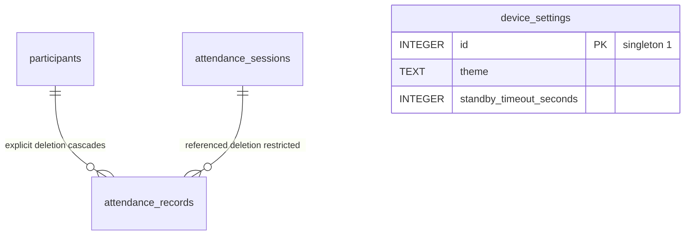

# Face Recognition

## Attendance kiosk interface and lifecycle

The optional PyQt5 Widgets interface defaults to a demonstration independent of
camera, model and dataset assets. It provides nine persistent screens: standby, attendance,
PIN access, administrator dashboard, sessions, records, export,
system status and settings. Without a database, records remain fictional. Export
requires a persistent database and a verified Linux USB destination; authenticated
persistent mode also provides real system diagnostics. Live recognition debug metrics describe the running pipeline.
Only modes **without a database** use demonstration PIN **123456** for navigation;
persistent modes require locally configured credentials, never this fallback.

Windows development (native Qt backend, 800 × 480 window):

```powershell
python -m pip install -e ".[gui]"
$env:PYTHONPATH="src"
python -m face_recognition.presentation.gui --windowed
```

The GUI extra pins the PyQt5 binding to 5.15.11 for desktop development; it is
not a recognition-core dependency. On Raspberry Pi use the already installed
system PyQt5 / Qt 5.15.8 through a `--system-site-packages` environment. Do not
replace the working system Qt/EGLFS installation with desktop wheels.

```bash
QT_QPA_PLATFORM=eglfs PYTHONPATH=src python -m face_recognition.presentation.gui
```

EGLFS launches fullscreen; the application does not set the platform backend.
Escape closes the development application. Dark Amethyst is the default theme;
Settings → Appearance (`Ajustes → Apariencia`) switches all existing widgets to
Light Lavender immediately. Preferences remain in memory without a database and
are persisted for authenticated administrators when a database is configured.
One recurring timer updates the date/time; one single-shot timer handles
Attendance inactivity. Demonstration mode starts no worker or recognition load.

The window distinguishes `LifecycleState.STANDBY`, `ATTENDANCE`, `ADMIN_LOGIN`,
`ADMIN` and terminal `SHUTDOWN` from its nine visible pages. All administrative
subviews belong to `ADMIN`. Main-content activation or sidebar Asistencia starts
a fresh Attendance countdown and clears the demo result. Deliberate clicks,
taps, keys and wheel interaction inside Attendance restart the countdown;
mouse movement does not. `Ajustes → Espera` selects 30 (default), 60 or 120 seconds.

The explicit `Simular rostro presente` checkbox is independent of the attendance
result selector: an unrecognized face is still presence. Presence stops the
timer, absence starts a new countdown, and expiry enters Standby. Leaving
Attendance clears presence/results and stops its timer. No attendance timer runs
in Standby, PIN entry or Admin. State/deadline checks reject obsolete timeouts.
Returning to Attendance or Standby clears demo authentication/PIN. Exit retains
the themed confirmation; cancellation keeps Admin active, and closing stops both
timers and announces shutdown. Standby never suspends the OS or display.

`window.lifecycle_changed` (enum) and `window.attendance_active_changed` (boolean)
announce lifecycle changes. Presence enters through `window.set_face_present(bool)`
on the GUI thread; repeated absence is idempotent and cannot postpone standby.
Without `--attendance-db`, the session page opens/closes an explicitly temporary,
in-memory session. With an explicit database it restores and manages persistent
sessions, while startup still enters Standby. Persistent USB export is described below. Settings
show read-only system date/time; no brightness adjustment is offered. Persistent modes add PIN change, preferences,
authorized maintenance and disabled-by-default Linux power requests (Phase 6).

Optional offscreen checks (skip automatically if PyQt5 is absent):

```powershell
$env:QT_QPA_PLATFORM="offscreen"
python -m unittest tests.unit.test_kiosk_gui tests.unit.test_gui_recognition
```

GUI code is contained in `presentation/gui`: `window.py` owns screens and
navigation, `themes.py` owns shared palette/style definitions, and `__main__.py`
starts the application. Only explicit live mode imports `recognition.py`, which
coordinates the existing recognition core with Qt. Demonstration mode imports no
camera, MediaPipe, NumPy or scikit-learn components.

### Live kiosk recognition

`--model-dir` opts into live recognition. The same camera/model options as the
standalone live CLI are available, including default **480 × 270** inference,
optional main-stream dimensions, landmarker asset, orientation and absence timeout.
There are no threshold, classifier or temporal overrides.

Windows PowerShell (native Qt):

```powershell
$env:PYTHONPATH="src"
python -m face_recognition.presentation.gui --windowed `
  --camera-backend opencv --camera-index 0 `
  --model-dir "..\face-recognition-data\v3\models\open_set_model_v3" --debug
```

Raspberry Pi (existing system Qt/EGLFS):

```bash
QT_QPA_PLATFORM=eglfs PYTHONPATH=src python -m face_recognition.presentation.gui \
  --camera-backend picamera2 \
  --model-dir "../face-recognition-data/v3/models/open_set_model_v3" \
  --orientation rotate180 --debug
```

Without a database, use demonstration Admin navigation to open a temporary session.
With a database, authenticate with the locally configured PIN and use `Sesiones`,
then return to `Asistencia`. Capture is eligible only in Attendance with an open
session and a ready backend. Without a session the camera remains closed. The
simulation controls are hidden in live mode. Accepted temporal identities display
`Identidad reconocida` and the technical ID; rejected decisions display `Persona
no reconocida` without the SVM candidate. Recognition never means attendance has
been registered unless the explicit recording capability described below is
enabled and the database confirms success. Ordinary mode hides technical diagnostics.
The sidebar identifies whether recording is enabled. Without a database,
temporary sessions and sample records remain demonstrations. Administrative PIN
access is explicitly a demonstration only when no database is supplied.

One Qt worker loads and fully validates the trusted bundle once, retaining it
across activations. It owns camera acquisition, asynchronous MediaPipe, pose
features and the existing `LiveOpenSetRecognition` pipeline. Each activation
creates a fresh detector and temporal stream. Standby, Admin and session closure
stop processing and release the camera/detector while retaining the model.
Generation checks reject late results. Partial initialization and capture errors
release resources and show a generic Spanish error; there is no rapid retry loop.
Leaving and reentering Attendance permits a new capture attempt. Model failures
require restarting after correcting the trusted assets/runtime.

The Qt preview deliberately reuses the **low-resolution inference frame**, not a
second camera read. Picamera2 keeps its existing RGB888 main/YUV420 lores
configuration; only lores is consumed here. Existing stride-aware YUV420-to-RGB
conversion crops padding; OpenCV BGR frames resize/convert to RGB using the same
preprocessing helper. `--preview-fps` limits image generation and rendering
(default 15 FPS; actual display rate also depends on the existing coalesced GUI
refresh cadence). Each published QImage copies its pixels into Qt-owned storage;
QPixmap creation and aspect-preserving scaling occur only on the GUI thread. There is no DRM preview,
OpenCV window, zero-copy assumption or extra preview backend inside EGLFS.
`--preview-width/height` configure acquisition/main stream; the embedded preview
still uses the inference resolution. The static positioning guide remains visible.

For CPU diagnosis, compare otherwise identical live runs with `--preview-fps 0`,
`--preview-fps 5` and `--preview-fps 15`. Zero displays `Vista previa desactivada`
and skips preview RGB conversion, QImage copying, QPixmap creation, scaling and
image updates. Camera acquisition, MediaPipe, recognition, facial presence,
status/debug delivery and lifecycle handling continue unchanged. This switch
isolates preview work; it does not establish the cause of high CPU usage or
promise a performance improvement. The standalone CLI and demo mode are unchanged.

A single replaceable packet holds the latest preview/result, with coalesced Qt
notifications and a single-shot refresh timer. Slow rendering drops intermediate
packets rather than queuing frames. MediaPipe still admits one inference at a
time, skips busy submissions and consumes each completion timestamp once. No
recognition mathematics, frozen threshold or seven-observation policy changes.
Fresh detector faces, including UNKNOWN and invalid-pose faces, signal presence;
stale snapshots expire under the existing absence timeout. Repeated empty results
do not restart inactivity. All image/landmark/feature processing is in memory only.

Debug text distinguishes camera reads/s, displayed preview images/s, MediaPipe
completions/s and valid recognition observations/s. It shows MP submission-to-
callback latency separately from submission-to-V3 observation latency, plus window
occupancy, busy skips, candidate, last completed temporal score and threshold.
These are not probabilities; observation latency excludes subsequent GUI rendering.
Metrics retain the existing approximately one-second measurement interval.

Exit stops activation immediately and keeps Qt alive until the worker releases
resources and joins. Stop flags are directly thread-safe, including during a
blocking capture loop. Native camera/loader calls cannot be forcibly interrupted;
cleanup waits for them to return, so a hung driver may delay final exit. No unsafe
thread termination is used. Manual Raspberry Pi 3B+ validation passed all 17
functional acceptance checks. The operator confirmed acceptable recognition
throughput, memory consumption, temperature and effective multicore execution.
Automated tests use synthetic fixtures and do not measure hardware performance.
For future on-device comparisons, use identical camera settings and compare
callback latency with callback latency, rather than with total recognition
latency. Touchscreen deployment remains separate work.

Operational facial dataset capture, pose-feature processing, selected-model
construction and single-face open-set recognition on Windows/OpenCV and
Raspberry Pi/Picamera2. Optional attendance management is described below; this
academic prototype is not a production-ready institutional attendance system.

The completed research is preserved in Git. **`v3-open-set-model` (`755a06f`)**
preserves the frozen research/model-construction workflows; **`v2-open-set-final`**
preserves the last independently evaluated external holdout. Research commands,
CV planning, comparisons, diagnostics and discarded classifiers/scorers are no
longer executable from current HEAD.

## Installation

Python **3.11** is supported. Keep the pinned requirements; do not copy virtual
environments between Windows and Linux.

Windows PowerShell, repository root:

```powershell
python -m venv .venv
.\.venv\Scripts\Activate.ps1
python -m pip install -e .
python tools/download_face_landmarker.py
```

Alternatively activate the existing `face-recognition` Conda environment and set
`$env:PYTHONPATH="src"` when running without an editable installation.

Raspberry Pi 3B+ reference: Debian 12 Bookworm/aarch64, Camera Module 3, Python
3.11.2 and system Picamera2 0.3.31/libcamera. Install the distribution's
`python3-picamera2`/`python3-libcamera` packages, then:

```bash
python3 -m venv --system-site-packages .venv
source .venv/bin/activate
python -m pip install -r requirements-rpi.txt
python -m pip install --no-deps -e .
python tools/download_face_landmarker.py
```

Picamera2/libcamera imports are isolated and lazy; Windows does not require them.
The MediaPipe asset is `assets/face_landmarker.task`, or supply `--landmarker-model`
to live recognition. Source code, requirements and trusted model assets can be
shared; interpreters and binary packages must be installed for each architecture.

## Architecture and preview

```text
Camera (OpenCV / Picamera2)
  → asynchronous MediaPipe Face Landmarker (LIVE_STREAM)
  → pose-relative XYZ features
  → loaded ANOVA / scaler / SVM / Mahalanobis
  → seven successful observations / median / deterministic identity vote
  → KNOWN identity or UNKNOWN overlay
```

The existing `domain`, `application`, `infrastructure`, `presentation` and `config`
layers remain. Camera acquisition is platform-specific; recognition is shared.
There is one active MediaPipe request, a latest-result slot, and immediate busy
frame discard before conversion. No inference backlog, worker or frame queue is
introduced. Each completed landmark result is consumed at most once.

Preview and performance utilities:

```powershell
python -m face_recognition.presentation.cli.recognize --camera opencv --display opencv
```

```bash
PYTHONPATH=src python -m face_recognition.presentation.cli.recognize --camera picamera2 --display drm --orientation rotate180
PYTHONPATH=src python -m face_recognition.presentation.cli.recognize --camera picamera2 --display none --landmarks none
```

`--landmarks none|selected|all` controls drawing; selected mode requires
`--indices INDEX,INDEX,...`. Orientation supports `normal`, `rotate180`,
`mirror-horizontal`, `mirror-vertical`. Preview defaults are 848×480 main and
480×270 inference. Picamera2 retains the shared-crop main preview plus lores YUV
inference stream, stride-aware conversion only after reserving inference, and
native DRM preview/transparent overlay. DRM and no-display modes do not convert
camera pixels for presentation. OpenCV live capture retains device defaults
unless explicit preview dimensions are supplied.

## Guided dataset capture

Capture writes raw landmarks and session metadata, validates existing captures,
and supports explicit resume. Use pseudonymous identifiers; no participant names
or images are required. SPACE begins/advances the guided conditions; q exits.

```powershell
python -m face_recognition.presentation.cli.capture --help
python -m face_recognition.presentation.cli.capture --person-id p001 --session-id session_01 --data-root "..\face-recognition-data\data\raw"
```

Use `--camera picamera2 --display drm` on Raspberry Pi and the appropriate
`--orientation` for the physical camera. The default guided protocol covers
center, near/far, roll, yaw, pitch and four translations. Capture parameters,
complete conditions, sample order and inference dimensions remain in manifests.
Rerun the same capture command with matching session configuration to resume;
existing complete conditions are validated rather than silently overwritten. Consult `--help`
for capture timing and backend options.

## Selected pose dataset

Process raw captures into a **new external output root**:

```powershell
python -m face_recognition.presentation.cli.process_dataset `
  --raw-root "..\face-recognition-data\data\raw" `
  --output-root "..\face-recognition-data\v3\pose_processed"
```

The command emits only `all_xyz_pose_v2`: 478 landmarks × XYZ = 1434 features,
with unchanged identity/session/condition/index/timestamp provenance. Completed
outputs cannot be overwritten. Failures retain failed staging metadata and never
publish a completed dataset. Historical processed datasets remain untouched.

The exact frozen transform corrects `(x, y*height/width, z)`, averages eye groups
`[33,133]` and `[362,263]`, uses their midpoint as origin and 3D separation as
scale, and builds an orthonormal right-handed frame. Horizontal points between
the eye centers; vertical is chin `[152,148,377]` minus forehead `[10,109,338]`,
Gram–Schmidt projected off horizontal; depth is their cross product, followed by
vertical reconstruction. Coordinates are `((p-origin)/scale) @ basis`. Collapsed,
collinear or non-finite geometry fails safely. The normalization and Mahalanobis
source files are intentionally unchanged because frozen bundles fingerprint them.
MediaPipe z is relative depth, not metric 3D frontalization.

## Model construction and calibration

The frozen configuration is authoritative: `all_xyz_pose_v2`, 1434 inputs,
`SelectKBest(f_classif, k=448)`, `StandardScaler`, RBF `SVC(C=4, gamma=0.001,
probability=False)` and predicted-class regularized Mahalanobis. Covariance uses
the existing per-class Ledoit–Wolf estimate, ridge
`1e-8*max(1, trace(covariance)/dimension)` and Cholesky solve. Knownness is negative
Mahalanobis distance. There are no method/hyperparameter overrides.

Model construction uses the frozen population metadata, not new split selection:
KNOWN sessions 01–03 fit every component exactly once; KNOWN session 04 and both
sessions of all eight designated UNKNOWN identities calibrate only. Membership
is read from authenticated metadata. UNKNOWN and KNOWN calibration data never
fit preprocessing, classifier or covariance statistics. Current declared real
counts are 7800 fitting frames, 2600 KNOWN calibration frames and 4160 UNKNOWN
calibration frames; actual catalog, per-condition counts and payloads are checked.

```powershell
python -m face_recognition.presentation.cli.train_recognition_model `
  --processed-root "..\face-recognition-data\v3\pose_processed" `
  --frozen-config "..\face-recognition-data\v3\models\open_set_config_v3.json" `
  --output-dir "..\face-recognition-data\v3\models\open_set_model_v3"
```

The existing bundle is already trained; cleanup and deployment do not require
running this command. An existing output directory is refused. Training retains
read-only authentication of the frozen protocol and pose-report provenance;
`--protocol` and `--pose-report` support relocated files only when hashes match.
It does not regenerate protocols, replay experiments or select strategies.

Threshold calibration uses non-overlapping, boundary-safe windows of seven and
median scores. It maximizes binary balanced accuracy with exact integer
comparisons, then lower FAR, lower FRR and higher numeric threshold. Enumeration
retains observed scores, finite interior midpoints and accept/reject boundaries.
AUC/EER are diagnostics. **No refit follows calibration**:
`threshold_transport="none_same_model_calibration"`. Component and full-state
fingerprints before and after calibration must match.

Calibration metrics are not independent test/generalization performance. No new
untouched V3 holdout exists; V2 remains the last independent external holdout.

## Model bundle and loading

```text
open_set_model_v3/
  model.joblib
  frozen_config.json
  manifest.json
```

Publication stages and round-trips artifacts, writes the completion manifest
last, verifies hashes/state and publishes the directory without overwrite.
The manifest contains aggregate calibration counts/metrics, provenance and
fingerprints. It does not contain raw features, individual scores or predictions.
The fitted selector/scaler/SVM/Mahalanobis state is biometric-derived and local.

```python
from face_recognition.infrastructure.persistence.recognition_model import load_recognition_bundle
recognizer = load_recognition_bundle(model_directory)
# features: seven finite all_xyz_pose_v2 rows, shape (7, 1434)
decision = recognizer.predict_window(features)
# decision.identity is None for UNKNOWN; score is a distance-derived value.
```

Only load trusted local joblib bundles: integrity hashes are not authenticity
signatures. Startup verifies manifest/artifact SHA-256, configuration,
implementation fingerprints, fitted structure, learned-state fingerprints and
calibration consistency before camera access. Python **major.minor** must match;
patch releases may differ. Recorded NumPy, SciPy and scikit-learn versions must
match exactly. No dependency upgrade or validation bypass is provided.

Historical internal class/module paths (`v3_open_set_config`,
`v3_deployable_model`, `sklearn_v3_novelty.FittedV3Identity`, `EvaluationVersions`)
remain where serialized objects and canonical fingerprints require them. They
contain compatibility schemas, not executable experiment workflows. Bundle/schema
identifiers, representation IDs, manifest builder IDs and frozen source hashes
are preserved; existing bundles need no migration.

Live inference uses lightweight fit-generation, component-identity and frozen
contract guards. It never rehashes/serializes large learned arrays per frame.
`recognizer.verify_integrity()` remains an explicit expensive diagnostic outside
the hot loop; lightweight guards do not detect arbitrary in-place array edits.

## Live recognition

Windows PowerShell:

```powershell
python -m face_recognition.presentation.cli.live_recognition `
  --camera-backend opencv --camera-index 0 `
  --model-dir "..\face-recognition-data\v3\models\open_set_model_v3"
```

Raspberry Pi:

```bash
PYTHONPATH=src python -m face_recognition.presentation.cli.live_recognition \
  --camera-backend picamera2 \
  --model-dir "../face-recognition-data/v3/models/open_set_model_v3"
```

Copy the entire unchanged three-file bundle, source package and MediaPipe task
asset to the Pi. No raw/processed dataset or experimental report is required for
live inference. OpenCV exits with q, ESC or Ctrl+C; native DRM exits with Ctrl+C.
Camera, detector, display and native preview resources close on errors and exit.

Seven **successful face inferences** form a non-overlapping window. Identity uses
plurality, ties by summed corresponding SVM decision scores across all seven
observations, then class order. Score uses median, without a consistency gate.
Accept `score >= persisted threshold` (current bundle: approximately
**-18.1917360542**). UNKNOWN suppresses the arbitrary SVM candidate identity.
The completed decision/score remains visible while the next window fills.

An observed no-face result or invalid pose immediately clears the partial
window. After `--absence-timeout` seconds (default 2), the last decision, score,
candidate and box clear to NO FACE. Old callbacks are rejected; a long gap before
reappearance resets partial observations. Single-face mode uses the first
returned face deterministically, without multi-face tracking or identity gates.

Normal overlay: face box, stable identity/UNKNOWN, last completed temporal score,
threshold, inference FPS, submission-to-V3 latency, window occupancy and camera
read FPS. `--debug` adds frame/temporal candidates, frame score, completions,
callback/busy counts and coarse **Pose+features / V3 observation** milliseconds.
Scores are not probabilities; there is no confidence percentage.

## Performance and tests

Camera FPS counts reads, not native DRM refresh. Live inference FPS counts
successfully consumed pose+recognition completions, excluding dropped/busy,
no-face and reused results. Live latency runs from MediaPipe submission through
callback/main-loop/pose/recognition/temporal completion. Preview inference FPS
counts callbacks, including no face. Preview timing breaks down preprocessing,
dispatch, async result and total callback time; reused results retain their timing.
Debug coarse timings do not change those callback semantics or add per-frame logs.

The retained LIVE_STREAM design previously measured about 7–8 active-face
MediaPipe completions/s and 114–120 ms callback latency on Raspberry Pi 3B+.
These are hardware observations, not an end-to-end recognition guarantee.

Hardware-free tests use synthetic fixtures and temporary directories only:

```powershell
$env:PYTHONPATH="src"
python -m unittest discover -s tests
git diff --check
```

On machines with heavily oversubscribed native numerical libraries, optionally
set `OPENBLAS_NUM_THREADS=1`, `OMP_NUM_THREADS=1`, `MKL_NUM_THREADS=1` for testing.
No test accesses the external biometric data tree or requires camera hardware.

## Research evidence and limitations

The following independent final holdout results are historical records only:

| Final metric | V1 | V2 |
| --- | ---: | ---: |
| Closed-set frame accuracy | 0.927692 | 0.878462 |
| Temporal ROC AUC | 0.736982 | 0.727761 |
| UNKNOWN false-acceptance rate (FAR) | 0.198718 | 0.416667 |
| KNOWN false-rejection rate (FRR) | 0.450000 | 0.280769 |
| Open-set exact accuracy | 0.644231 | 0.649038 |

V2 evaluated 10 known identities / 10 sessions / 2600 frames and 3 new unknown
identities / 6 sessions / 1560 frames. Its final closed-set macro F1 was 0.876944.
Its selected development temporal AUC/open-set accuracy were 0.846953/0.774231,
which did not transfer to the independent final population. Lower known false
rejection came with unacceptably high false acceptance on new unknown identities.
Calibration and development results are not final generalization measurements.

Neither archived model may be retuned from these final results. Changes to
normalization, features, rejection/threshold policy, classifier or temporal
policy belong to a new model version and experimental protocol.

The completed iterative comparison selected **all_xyz_pose_v2** under the
predeclared highest-mean-outer-balanced-accuracy rule. These are development
cross-validation results, **not independent final generalization**:

| Metric | all_xyz_v1 | all_xyz_pose_v2 |
| --- | ---: | ---: |
| Closed-set accuracy | 0.897500 | 0.948173 |
| Closed-set macro F1 | 0.897409 | 0.948020 |
| ROC AUC | 0.835956 | 0.890893 |
| EER | 0.229808 | 0.179567 |
| FAR | 0.120192 | 0.098558 |
| FRR | 0.302885 | 0.261538 |
| Open-set exact accuracy | 0.745879 | 0.782280 |
| Binary balanced accuracy | 0.788462 | 0.819952 |

Global improvement does not resolve pose sensitivity. KNOWN yaw-left FRR fell
from 0.725000 to 0.662500, and yaw-right from 0.862500 to 0.762500; both remain
difficult. Pitch-up did not improve (0.500000 to 0.512500); pitch-down remained
0.412500. Session/context variation and harder-to-reject UNKNOWN identities
(including p009 in prior diagnostics) remain limitations. MediaPipe relative
depth is not metric 3D geometry. These limitations motivate no tuning in the
freeze workflow.


The cross-validated representation comparison is iterative development evidence;
it is not an independent final holdout. V3 research/model-selection commands are
available only from the frozen historical tag. Residual yaw/pitch sensitivity,
session/context variation and harder-to-reject UNKNOWN identities remain known
limitations. No explicit lighting labels exist. Do not retune frozen model
versions from archived final results.

## Attendance management

Four modes are deliberately separate:

| Launch options | Behavior |
| --- | --- |
| Neither database nor model | Existing nonpersistent, hardware-independent demonstration |
| `--attendance-db` only | Persistent **synthetic demonstration**, no camera or biometric assets |
| `--model-dir`, without recording opt-in | Live recognition; accepted decisions say `Identidad reconocida`. An optional database provides sessions/records, but recognition does not write attendance |
| Model + database + `--enable-attendance-recording` | Explicit live persistent attendance capability for pre-registered identifiers |

The recording flag requires both paths. It enables software behavior only; it
does not establish authorization or valid consent. Never repurpose a synthetic
testing database for operational collection. The default startup creates no
database, enrolls no participants and generates no attendance.

Register fictional participants explicitly before synthetic acceptance testing:

```bash
PYTHONPATH=src python -m face_recognition.presentation.cli.admin \
  --attendance-db "$HOME/.local/share/face-recognition/synthetic-attendance.sqlite3" setup
PYTHONPATH=src python -m face_recognition.presentation.cli.attendance_participants \
  --attendance-db "$HOME/.local/share/face-recognition/synthetic-attendance.sqlite3" add p001
PYTHONPATH=src python -m face_recognition.presentation.cli.attendance_participants \
  --attendance-db "$HOME/.local/share/face-recognition/synthetic-attendance.sqlite3" list
QT_QPA_PLATFORM=eglfs PYTHONPATH=src python -m face_recognition.presentation.gui \
  --attendance-db "$HOME/.local/share/face-recognition/synthetic-attendance.sqlite3"
```

Windows PowerShell equivalent (native Qt, repository root):

```powershell
$env:PYTHONPATH="src"
$syntheticDb=Join-Path $env:LOCALAPPDATA "face-recognition\synthetic-attendance.sqlite3"
python -m face_recognition.presentation.cli.admin --attendance-db "$syntheticDb" setup
python -m face_recognition.presentation.cli.attendance_participants --attendance-db "$syntheticDb" add p001
python -m face_recognition.presentation.cli.attendance_participants --attendance-db "$syntheticDb" list
python -m face_recognition.presentation.gui --windowed --attendance-db "$syntheticDb"
```

Participant commands initialize only the explicitly selected database, reject
duplicate/invalid identifiers and never inspect models to discover participants.
There are no names, identity mappings or enrollment operations. Registration of
an identifier does not establish consent.

Configure and authenticate with your local administrator PIN, enter
`Sesiones → Crear sesión`, supply a name and an explicit
calendar date, then select `Crear e iniciar sesión`.
Return to `Asistencia`: select `p001 · Aceptar` and click `Simular decisión`.
Repeat for duplicate attendance; select `UNKNOWN · Rechazar` for no write, or
`p003 · Aceptar` to test an unregistered identifier (leave p003 unregistered).
Simulated decisions use the same service and real SQLite constraints as live
decisions, but no facial data. The controls stay hidden in live mode.

Persistent sessions have authoritative database-generated IDs, names, opening
times, open/closed state, activation revisions and counts. Camera activation still requires Attendance
and an open session; opening in Admin does not start capture. Closing preserves
history, stops eligibility and clears transient results. Exiting the application
does **not** close a session. Restart restores any open session, initially in
Standby. Temporary sessions remain available when no database is supplied.

An attendance session is **one event identified by normalized name and explicit
calendar date**. `Optimización` on 2026-11-16 and on 2026-11-23 are different
sessions; a participant can attend each once. Different names can share a date.
Name normalization remains Unicode NFC, whitespace trim/collapse, case folding
and NFC again; display case and accents are preserved (`Inglés` differs from
`Ingles`). Whitespace controls collapse; other controls/format characters are
rejected. SQLite `NOCASE` is not used.

The existing Sesiones screen has three tabs, with active-session information and
`Cerrar sesión activa` accessible above them:

- **Crear sesión:** name and `QDateEdit` (today by default), then `Crear e iniciar
  sesión`. Creation always inserts a new event. An existing name/date reports
  `Ya existe una sesión con ese nombre y fecha. Selecciónala en Gestionar sesiones.`
  It never resumes implicitly. Another active event blocks creation.
- **Gestionar sesiones:** linked name/date selectors. Dates list only events for
  the selected normalized name; the selected event ID is authoritative. The
  summary shows name, event date, state and count. `Reanudar sesión` preserves ID,
  event date, original opening time and all attendance/timestamps, clears
  `closed_at` and advances the activation revision only on a closed-to-open
  transition. Existing attendance remains a duplicate for that event. `Editar
  sesión` provides name/date inputs and explicit `Guardar cambios`/`Cancelar`;
  editing is restricted to closed sessions and rejects name/date collisions.
- **Eliminar sesiones:** three targeted operations described below, requiring authenticated
  administration and fresh PIN verification. The scope mirrors the management selection with name, date and count.

Session dates are Python `datetime.date` values stored as `YYYY-MM-DD`; they are
not opening timestamps or registration timestamps. Editing the event date never
rewrites `registered_at`. Renaming/editing changes only the selected event, not
other dates with the same normalized name. Selectors preserve event IDs on refresh;
counts use one grouped query. `closed_at` is current closure state, not a full
activation audit log. All four launch modes, Standby, theme handling, preview FPS
and camera lifecycle remain unchanged. No session activation-history table is added. Local administrator security and
scoped maintenance are described below.

### Administrator-authorized deletion

All persistent modes require configured administrator credentials. The former
`--enable-synthetic-session-deletion` flag is rejected with a migration message;
there is no alternative flag bypass. Use disposable synthetic databases for
validation. Every targeted deletion requires an authenticated administrator,
its exact confirmation preview, and fresh PIN verification. The same flow is
available in persistent synthetic and live modes; authorization is not based on
whether the camera is active. Attendance-data deletion remains blocked while
any attendance session is open.

| Action | Deleted | Preserved |
| --- | --- | --- |
| `Vaciar asistencias de esta sesión` | Records for the selected name/date event | That event's ID/name/date/opening time; other events; participants/settings |
| `Eliminar sesión de esta fecha` | Selected event and its records | Other dates and names; participants/settings |
| `Eliminar sesiones de todas las fechas` | All events and records for the selected normalized name | Other names and their records; participants/settings |

All three operations reject while **any** session is active, in both service and
transaction checks. Empty target scopes are disabled. Every action prepares a
read-only preview and opens its own themed confirmation with actual names, dates,
affected/deleted session counts, record counts, preservation explanation and an
application-irreversibility warning. All-dates summaries list every date/count
inside a scroll area. `Cancelar` is the default; Escape or closing the dialog
writes nothing. A specific destructive button is required to execute.

Confirmed execution takes `BEGIN IMMEDIATE`, rechecks active sessions and compares
the exact selected scope and full session/record snapshot against the preview,
including row identities and values, not just totals. Changed records, equal-count
replacements, edited targets or added dates abort and require a new confirmation.
Records are deleted first, then sessions where applicable, respecting the existing
`ON DELETE RESTRICT`. Both changes commit together or roll back. Actual deleted
counts are reported and selectors/Records filters refresh. No database file is
replaced or removed, and no participant, setting, credential, model or biometric
file is deleted. Clearing records preserves the event for later resumption and
fresh attendance.

The two integer identity tables use SQLite **AUTOINCREMENT** and guards against
explicit reuse/mutation of IDs. SQLite's internal `sqlite_sequence` high-water
marks survive targeted deletion, including deletion of the last event/record.
Never reset them manually. A deleted event recreated with the same name/date has
a new ID; stale recognition cannot target it. The same rule prevents a newly
inserted record with identical values from masquerading as a confirmed old record.
Activation revisions, worker generations, temporal decision sequences, freshness
and face-segment checks remain required. Clearing then resuming still advances
activation revision, rejecting old decisions. No recognition math changes.

Phase 6 adds local administrator authentication, scoped reauthentication,
maintenance operations and opt-in power requests as described below. Nonpersistent
demonstration authentication provides no persistent administrative authorization. Administrative attendance deletion is distinct from
biometric-data suppression and does not securely erase storage pages, journals,
backups or flash.

`AttendanceService` coordinates session operations, participant eligibility,
duplicate results, grouped counts and record filters over the existing repositories.
SQLite schema version **4** preserves the four attendance/settings tables and adds credentials. New registrations show `Asistencia
registrada`; duplicates show `Asistencia ya registrada` with the **original**
registration time. Missing participants, closed sessions and storage failures
produce distinct Spanish outcomes, never false success or temporary fallback.
Confirmation remains visible while the same face segment continues; leaving
Attendance, losing presence or changing session clears it.

Only completed temporal windows carry a decision sequence and completion time.
The sequence changes once per window, independently of general view revisions.
The GUI consumes it at most once per activation, requires a current valid face
segment, rejects expired evidence and binds it to the active session ID **and
activation revision**, as well as the recognition worker generation. No-face
or invalid-pose interruptions invalidate cached attendance evidence while leaving
the existing recognition grace-period display unchanged. Rejected decisions and
individual frame candidates never write. Coalesced packets may skip intermediate
decisions; no unbounded decision/frame queue or per-frame database query is added.
The existing atomic repository insertion remains the final authority on session
validity, expected revision and uniqueness in the same `BEGIN IMMEDIATE`
transaction. A close/resume of the same ID cannot admit a pending request from its
old activation. Revision changes reset the worker generation, temporal stream and
transient confirmation state. No recognition mathematics or fitted artifacts change.

`Registros` reads SQLite on entry or filter changes, including closed-session
history. Its session selector defaults to `Todas las sesiones`; its date filter
defaults to checked with today's local date. Combine session and date, or disable
the date filter for a selected session's full history. Without both a session and
a date restriction, the UI requests a selection and the repository refuses an
unrestricted query. Results show participant, current session name, local date
and time, and total/empty state, in chronological order. Filtering uses IDs,
never mutable display names. Records and session names are queried in batches,
not per table cell.
The selected local day's start and the **next local day's start** are resolved
independently by Qt's system timezone and converted to UTC for `[start,end)`;
days spanning offset changes need not be 24 hours. Stored datetimes remain aware UTC.

Persistence runs synchronously on explicit GUI actions/eligible decision events,
using separate short-lived connections and a **150 ms busy timeout** in the GUI
and participant CLI. It does not run inside camera capture, MediaPipe callbacks
or the recognition worker. Recoverable failures leave navigation/exit available;
failed initialization disables persistent session controls instead of falling
back. No database polling worker is introduced. Credential derivation alone uses
a short Qt task; settings persist only on explicit preference changes. A busy database can briefly delay GUI delivery; camera
processing continues and old packets are still rejected.

Live recording capability example only, after privacy/access-control review and
with a separate reviewed database (do not execute against real data for testing):

```bash
QT_QPA_PLATFORM=eglfs PYTHONPATH=src python -m face_recognition.presentation.gui \
  --camera-backend picamera2 --orientation rotate180 \
  --model-dir "../face-recognition-data/v3/models/open_set_model_v3" \
  --attendance-db "/path/to/reviewed-attendance.sqlite3" \
  --enable-attendance-recording --preview-fps 15 --debug
```

On Windows, use the same flags with `--windowed --camera-backend opencv
--camera-index 0` and native Qt. Omitting the recording flag preserves identity-only
live behavior. `--preview-fps 0` still disables image work without stopping recognition.

Focused Raspberry Pi validation, synthetic fixtures only (no training tests):

```bash
QT_QPA_PLATFORM=offscreen PYTHONPATH=src python -m unittest \
  tests.unit.test_attendance_persistence tests.unit.test_attendance_service \
  tests.unit.test_attendance_sessions tests.unit.test_session_dates_deletion \
  tests.unit.test_gui_attendance tests.unit.test_kiosk_gui \
  tests.unit.test_gui_recognition tests.unit.test_live_open_set_recognition \
  tests.integration.test_live_open_set_cli
```

Phase 4's 27 persistence checks passed on Raspberry Pi, including POSIX
permissions. Its complete Pi suite was manually interrupted after about 20
minutes; it is **not** recorded as a full-suite pass. The initial Phase 5 focused
suite (114 checks) and 18 functional acceptance checks subsequently passed on Pi.
The dated-session/deletion revision also passed targeted and manual Pi acceptance
checks, as reported by the operator. The pre-merge cleanup must still be checked
on Pi using the focused command above; no new hardware measurements are claimed.
Windows development should also run `python -m unittest discover
-s tests` with `PYTHONPATH=src` and the Qt offscreen backend.

## SQLite schema and privacy

Standard-library `sqlite3` provides local storage without an ORM, server or new
dependency. Repositories are used through the attendance service above. Device preferences and administrator credentials are persistent only with an
explicit database. Nonpersistent modes retain demonstration authentication. Only an explicit
`--attendance-db` initializes storage; module imports and ordinary demonstration
startup never create or open a database.

Supply an explicit database path outside the source repository, biometric dataset
and model bundle. A possible future Linux location is
`~/.local/share/face-recognition/attendance.sqlite3`; no production location is
created automatically. With `db_path` supplied by the caller:

```python
from face_recognition.infrastructure.persistence.attendance_database import AttendanceDatabase
from face_recognition.infrastructure.persistence.attendance_repositories import SQLiteDeviceSettingsRepository

database = AttendanceDatabase(db_path)
database.initialize()
settings = SQLiteDeviceSettingsRepository(database).get()
```

Initialization uses `PRAGMA user_version`: version 0 creates schema **4** directly;
version 1 follows its supported normalization/collision migration to v2 and then
v3 and v4; version 2 migrates through v3 to v4; version 3 adds credentials
transactionally; version 4 validates and reopens. Unsupported versions,
nonempty unversioned databases and incomplete/weakened schemas fail explicitly.
Defaults are inserted only for a new database. No automatic recovery/reset occurs.

Migration to v3 infers each event date from its original aware UTC `opened_at`
converted using the device's local timezone rules for that instant. The
`AttendanceDatabase(..., migration_timezone=tzinfo)` boundary allows deterministic
synthetic timezone tests; normal GUI initialization uses the OS local timezone.
These dates are **inferred** and can be corrected by editing closed sessions.
Stored names, including date-looking text, are not parsed or rewritten.

SQLite cannot ALTER an integer primary key into AUTOINCREMENT. The v2→v3 migration
therefore rebuilds only sessions and their dependent records inside one transaction,
with foreign keys **ON** throughout: copy parent/child rows preserving IDs, drop
old child before old parent, rename the copied tables and recreate constraints.
This migration-only rebuild is necessary for non-reusing identities; destructive
session actions themselves use only targeted DELETE statements, never DROP/reset.
The four attendance/settings tables remain intact; v4 adds `admin_credentials`.
`sqlite_sequence` is SQLite's internal allocator.
New and migrated databases enforce the same date/composite-uniqueness/identity
constraints. Original timestamps, revisions, participants, records, settings and
file protection are preserved. Integrity/FK checks precede the version update and
commit; any failure rolls back the entire migration. Genuine v1 and v2 schema
fixtures test this path. Existing v1 normalized-name collisions still require
deliberate offline maintenance; they are never automatically merged or discarded.

| Table | Columns and principal constraints |
| --- | --- |
| `participants` | `person_id TEXT PRIMARY KEY NOT NULL`, `created_at TEXT NOT NULL` |
| `attendance_sessions` | `id INTEGER PRIMARY KEY AUTOINCREMENT`, nonempty `name`/`name_key`, valid NOT NULL `session_date`, unique `(name_key, session_date)`, UTC opening/closure times, positive `activation_revision` |
| `attendance_records` | `id INTEGER PRIMARY KEY AUTOINCREMENT`, `person_id NOT NULL` FK, `attendance_session_id NOT NULL` FK, `registered_at NOT NULL`; unique `(attendance_session_id, person_id)` |
| `device_settings` | `id INTEGER PRIMARY KEY CHECK(id=1)`, `theme` limited to `dark/light`, integer timeout limited to `30/60/120`; both preferences NOT NULL |
| `admin_credentials` | Optional singleton `id=1`; binary PBKDF2 hash/salt, versioned algorithm/work factor, failed-attempt count, optional UTC lock expiry, UTC creation/update times |



An attendance session is open exactly when `closed_at IS NULL`. A partial unique
index on the constant `1` for open rows enforces at most one open session, even
for competing writers. Attendance IDs are independent integer IDs, unrelated to
biometric capture names such as `session_01`. Technical participant IDs use `p`
followed by at least three ASCII digits (for example fictional `p001`). They must
be registered explicitly; no identity or enrollment is inferred from model output.

All four domain dataclasses live in `domain.models.attendance`; they have no SQLite,
Qt or ML dependency. The focused infrastructure repositories expose:

| Repository | Operations |
| --- | --- |
| `SQLiteParticipantRepository` | `add`, `get`, `list`, `exists`, explicit `delete` |
| `SQLiteAttendanceSessionRepository` | `open`, `get`, `current`, `close`, chronological `list` |
| `SQLiteAttendanceRecordRepository` | `add`, `get`, `list_for_session`, `list_for_participant`, `list_between`, `count_for_session` |
| `SQLiteDeviceSettingsRepository` | `get`, `update_theme`, `update_standby_timeout` |

Construct repositories with the initialized `AttendanceDatabase`. Writes require
explicit timezone-aware `datetime` arguments. Dataclasses normalize these to UTC;
storage uses fixed microsecond ISO 8601 `YYYY-MM-DDTHH:MM:SS.ffffffZ`. Database CHECKs
reject malformed timestamps; canonical UTC text supports chronological ordering.
`list_between(start, end)` requires `start < end` and uses **[start, end)**. Lists
use deterministic ID tie-breaks for equal timestamps. The GUI performs local
timezone conversion for display.

Each operation owns a short-lived connection with foreign keys enabled, the
default 5-second busy timeout and unchanged `check_same_thread` enforcement. No
connections are shared between threads. Writes use `BEGIN IMMEDIATE`: session
validation and attendance insertion hold one write reservation, so concurrent
closure/deletion cannot slip between them. Reads use short consistent transactions.
Successful operations commit; failures roll back; connections always close.

Session repositories also provide name/date lookup, distinct names and available
dates, explicit `resume`, closed-event `edit`, and grouped `list_with_counts`.
Creation rejects existing name/date pairs; resumption is explicit by session ID.
The service exposes these operations as focused outcomes (created, resumed,
already active, conflicting active session, duplicate name, missing session, failure).
The repository generates the canonical Unicode key; database uniqueness and
INSERT/UPDATE triggers reject missing/empty/NUL-containing keys. An empty column
default permits safe ALTER backfill but is rejected on every subsequent write.
Reopening also validates that stored keys match the domain normalization policy.

`records.add(..., expected_activation_revision=revision)` returns `(record, created)`.
The revision must come from the activation that produced the decision; it must not
be refreshed to the latest revision to retry a stale request. For existing initial-
activation callers, omission means **1**, not "whichever activation is current".
A duplicate in an open session with the correct revision
returns the original record and `False`, preserving its timestamp. Closed sessions
and mismatched revisions reject registration, including repeated requests. The
filtered `query` accepts a session, a half-open UTC range, or both; it refuses
unrestricted all-session history. No `INSERT OR REPLACE` is used.
The existing unique index serves session lookups/counts; additional indexes serve
participant/time and timestamp-range queries. There is no duplicate session index.

Deleting a participant explicitly cascades their attendance records in the same
transaction. Session deletion is restricted while records reference it; closing
never deletes history. Missing mutation targets raise `LookupError`; invalid input,
duplicates, closed-session writes and incompatible versions raise `ValueError`.
`get` methods return `None` when absent. Storage, corruption and locking errors
raise `AttendancePersistenceError` with the original SQLite exception chained.

The default **DELETE rollback journal** is retained; short, low-frequency writes
can wait for readers, and competing writers serialize. No WAL, connection pool,
database thread or automatic backup is added. New files use POSIX mode `0600` and
new directories `0700`, subject to the caller's umask; existing parent permissions
are not changed. On Windows, access protection depends on filesystem ACLs. SQLite
is **not encrypted at rest**. Git ignores database files and their sidecars/backups;
keep any differently named copies outside Git as well.

Synthetic persistence checks create temporary databases only:

```bash
PYTHONPATH=src python -m unittest tests.unit.test_attendance_persistence
```

Pseudonymous attendance data is not anonymous and a participant row does not prove
consent. The schema stores no names, identity mappings, biometric payloads, scores,
unknown-face events or plaintext credentials; schema v4 stores administrator hashes and lockout metadata separately. Before real collection, review authorization,
retention, withdrawal and deletion obligations, including the project's
**December 31, 2026 biometric-processing deadline**. This foundation does not
authorize indefinite retention of participant-related records or trained artifacts.
SQL deletion is not secure erasure of storage pages, journals, backups or flash.
Real participant collection is not authorized by this implementation. Withdrawal
workflows, deployment hardening and scheduled retention jobs remain unimplemented.

## Privacy

Raw landmarks, processed features, trained selectors/scalers/SVMs, covariance
references and model bundles are sensitive biometric-derived artifacts. Keep
all generated data and bundles local and outside Git. Existing `.gitignore`
protections for datasets, `models/`, `*.joblib`, `*.npz`, MediaPipe assets and
secrets remain. Do not put participant names, raw payloads, individual predictions
or scores in documentation. Attendance integration is an explicitly enabled
academic capability; no camera payload, rejected identity, score or recognition
history is persisted. Purpose, authorization, retention, withdrawal, deletion and
access-control requirements must be verified before real participant collection.


## Local administration and security (Phase 6)

Schema **4** retains all v3 attendance constraints, IDs, activation revisions,
timestamps and AUTOINCREMENT high-water marks. A transactional v3→v4 migration
adds only `admin_credentials`; v1→v2→v3 and v2→v3 remain supported before this step.
Failure rolls back the whole migration. Credentials are never created by migration.
The singleton table stores `id=1`, a 32-byte BLOB `pin_hash`, random BLOB `pin_salt`
(at least 16 bytes), `algorithm=pbkdf2_sha256_v1`, integer `iterations>=600000`,
nonnegative `failed_attempts`, optional canonical UTC `locked_until`, and canonical
UTC `created_at`/`updated_at`. No plaintext PIN or successful login is persisted.
There are five business tables plus SQLite's internal allocator.

Configure the administrator locally **before** exposing a persistent kiosk.
`admin setup` initializes/migrates only the selected database and uses hidden
`getpass` prompts for a six-ASCII-digit PIN and its confirmation. Leading zeroes
are significant. Trivial sequences and repeated digits are rejected. Repeated
setup never replaces credentials. There is no master PIN or recovery bypass;
forgotten-PIN recovery requires a future controlled maintenance procedure.
An unconfigured persistent GUI denies protected navigation but allows safe exit.
Live attendance recording fails closed without configured credentials.

PIN storage uses standard-library PBKDF2-HMAC-SHA256, **600,000 iterations**, a fresh
cryptographic salt for setup/change, and `hmac.compare_digest`. The algorithm/work
factor is versioned and validated, with no downgrade below this baseline. Raspberry
Pi 3B+ production-derivation benchmark supplied by the operator (600,000
iterations, 32-byte key, 16-byte salt): runs **2560.84, 2553.11, 2562.34, 2553.62,
2562.34 ms**; mean **2558.45 ms**, median **2560.84 ms**, maximum **2562.34 ms**.
This measures derivation, not the whole GUI operation. `--debug` reports the
complete authentication task latency without PINs, hashes or salts. A successful
PIN change performs two derivations. These figures explain why derivation must
not hold SQLite's write reservation; the production work factor remains unchanged.
No lower work factor was chosen to improve UI responsiveness. PBKDF2 executes in
one short-lived Qt authentication task, separate from recognition; the event loop
remains responsive. Once credential change is submitted, its dialog cannot be
cancelled mid-transaction. Input fields are cleared after submission/closure.

Five consecutive incorrect attempts impose a 60-second persistent lockout. Further
five-attempt groups escalate to 120 and then at most 240 seconds. Successful
verification resets the counter and lock. Login, PIN change and fresh operation
verification use optimistic authentication: a short read validates eligibility,
then closes before PBKDF2. A short `BEGIN IMMEDIATE` re-reads the complete credential
stamp (hash, salt, algorithm, work factor and creation/update timestamps), checks
the current lockout and updates the latest counter. Replaced credentials yield
failure with no retry or accounting against the replacement. An in-flight result
cannot bypass or extend a newly active lockout. The supplied UTC clock is read
after write-lock acquisition, so hashing/contention cannot shorten a new lockout;
a rollback of the clock during verification fails closed. PIN changes derive both
old/new hashes outside transactions and atomically replace only still-current,
unlocked credentials; no preliminary counter reset occurs. Busy timeouts, schema
v4 and the 60/120/240-second policy are unchanged. Locked attempts do not derive hashes. The GUI displays a nonblocking countdown. Screen changes or
process restarts cannot clear the database lock. A wall-clock rollback can extend
lockout; moving the clock forward can shorten it. A time earlier than credential
change is rejected conservatively. Reliable device time and privileged OS access
remain deployment responsibilities.

Protected navigation includes Dashboard, Sesiones, Registros, Exportar a USB,
Estado and Ajustes. `Cerrar sesión administrativa`, public Attendance, Standby and
application exit invalidate login and outstanding operation grants, without closing
the attendance event. No administrator inactivity timeout is added. `Cambiar PIN`
requires current/new/confirmation via masked fields and the touch keypad; success
uses a new salt and requires a new login. Nonpersistent demonstration and
identity-only recognition without a database retain clearly labelled demonstration
navigation and cannot perform persistent maintenance or power operations.

Appearance and 30/60/120-second standby preferences load without startup writes.
Explicit updates preserve unrelated settings; failures restore the previous GUI
selection. System date/time are read-only and share the footer clock; no brightness
control is presented. USB reports and complete backups require separate confirmation and fresh PIN verification.

A normal login is insufficient for a destructive action. Confirmation comes first,
then fresh PIN verification issues a 60-second, operation/snapshot-bound, single-use
in-memory grant. Logout, navigation, cancellation, PIN change, expiration, success
and failure invalidate pending grants. Both application authorization and final
repository checks apply; authorization for one scope cannot execute another.
Existing exact-row targeted deletion previews remain intact.

Ajustes → Almacenamiento y datos provides:

| Action | Deletes/resets | Preserves |
| --- | --- | --- |
| Eliminar historial de asistencias | All records and sessions | Participants, credentials, preferences, schema, ID sequences, biometric artifacts |
| Restablecer datos administrativos | All records, sessions and participants | Credentials, preferences, schema, ID sequences, biometric artifacts |
| Restablecer preferencias | Dark theme and 30-second timeout | All attendance, participants, credentials and biometric artifacts |

Confirmations show actual session/record/participant counts, preservation details,
operation-specific actions and safe default `Cancelar`. Escape/closure cancels.
History/admin-data reset reject any open session, hash the exact intended rows,
revalidate inside the write transaction and detect even equal-count replacements.
Dependent records are removed first; failures roll back. No DB file/table/sequence
reset occurs. Removed participants must be explicitly registered again; model
predictions never restore them. Preference reset applies to the UI only after commit.

Estado samples CPU deltas from `/proc/stat` relative to total system CPU capacity,
RAM using `MemAvailable`, validated thermal-zone temperature, and filesystem used/
available space via `disk_usage` at the configured database filesystem. Unsupported
metrics say `No disponible`, especially Linux-only metrics on Windows. Actual DB
schema/counts and credential configuration refresh on screen entry, not every
sample. A two-second timer samples only while Estado is visible. Model readiness,
camera activity and attendance state come from existing in-memory integration;
no camera/model initialization occurs for diagnostics. A protected participant
dialog lists only technical IDs and registration dates. No credential material or
biometric paths are displayed.

Power actions are disabled by default. `--enable-system-power-actions` requires
Linux, a persistent DB and configured credentials. Explicit confirmation and fresh
PIN verification precede the existing graceful shutdown: recognition/camera work
stops and joins, then `systemctl reboot` or `systemctl poweroff` runs with argument
lists, no shell/sudo/embedded credentials. Persistent attendance sessions remain
open for recovery. Failure returns a clear error and nonzero exit after safe app
closure; relaunch to retry or inspect deployment permissions. There is no success
claim merely because a request was made. sudoers/Polkit/deployment configuration
and hardware power testing remain future controlled deployment work. Ordinary
synthetic validation must **not** enable this option.

Disposable Raspberry Pi workflow (no real participant data):

```bash
TEST_DIR=$(mktemp -d -t face-id-phase6-XXXXXX)
DB="$TEST_DIR/attendance.sqlite3"
PYTHONPATH=src python -m face_recognition.presentation.cli.admin --attendance-db "$DB" setup
PYTHONPATH=src python -m face_recognition.presentation.cli.attendance_participants --attendance-db "$DB" add p001
QT_QPA_PLATFORM=eglfs PYTHONPATH=src python -m face_recognition.presentation.gui --attendance-db "$DB"
```

Windows PowerShell (native Qt):

```powershell
$env:PYTHONPATH="src"
$testDir=Join-Path $env:TEMP ([guid]::NewGuid().ToString())
New-Item -ItemType Directory -Path $testDir | Out-Null
$db=Join-Path $testDir "attendance.sqlite3"
python -m face_recognition.presentation.cli.admin --attendance-db "$db" setup
python -m face_recognition.presentation.cli.attendance_participants --attendance-db "$db" add p001
python -m face_recognition.presentation.gui --windowed --attendance-db "$db"
```

For migration validation, copy **only a disposable synthetic v3 database** to a new
scratch directory while its application is closed. Run `admin --attendance-db
"copied-path" setup` against the copy; inspect session IDs, dates, counts, settings
and original registration timestamps after login. Keep the original synthetic
fixture unchanged. Never select an operational or biometric database.

Focused Pi regression (synthetic fixtures, no expensive model-training tests):

```bash
QT_QPA_PLATFORM=offscreen PYTHONPATH=src \
OPENBLAS_NUM_THREADS=1 OMP_NUM_THREADS=1 MKL_NUM_THREADS=1 python -m unittest \
  tests.unit.test_administration tests.unit.test_admin_concurrency tests.unit.test_device tests.unit.test_gui_administration \
  tests.unit.test_attendance_persistence tests.unit.test_attendance_sessions \
  tests.unit.test_session_dates_deletion tests.unit.test_attendance_service \
  tests.unit.test_gui_attendance tests.unit.test_kiosk_gui \
  tests.unit.test_gui_recognition tests.unit.test_live_open_set_recognition \
  tests.integration.test_live_open_set_cli
```

Run the complete development suite with `python -m unittest discover -s tests`.
Validate on-device setup, lockout/restart persistence, change/logout, theme/timeout
reopening, scoped/global cancellation and exact previews, diagnostics timer behavior,
and camera release on protected navigation. Test power confirmation/authorization
with fakes; do not execute hardware power commands in ordinary validation.

A six-digit PIN has limited entropy. This is local kiosk access control, not
protection against privileged OS users, arbitrary in-process Python, direct SQLite
access or unrestricted physical access. SQLite is unencrypted by default. Row
deletion is not secure erasure of pages, journals, backups or flash, and is separate
from biometric suppression. Authorization/consent, retention/withdrawal, physical
security and the existing December 31, 2026 biometric-processing deadline still
require review before real attendance collection. This prototype is not production
ready. No recognition policy, model artifact or external biometric data was changed.


### Authentication regression test boundaries

`AdministrationTests` explicitly retains real production PBKDF2 in
`test_hash_salt_constant_time_and_plaintext_not_stored`,
`test_change_pin_verifies_current_new_salt_logout_old_rejection`, and
`test_concurrent_failed_attempts_are_atomic`. They cover real setup, leading-zero
verification, incorrect/old PIN rejection, fresh salts, constant-time comparison,
600,000 iterations, persistence, changes and five concurrent failures. A guard
asserts that these cases do not inherit the derivation substitute.

Other authentication-behavior, attendance and GUI tests explicitly scope
`tests.admin_fakes.use_fast_credentials` to one test. This mocks only the derivation
boundary with a deterministic **test-only** digest; SQLite transactions, credential
state, lockout counters and application authorization remain real. It does not
add a production fast mode, CLI bypass or reduced production work factor.
`tests.unit.test_admin_concurrency` uses events/barriers and injected clocks for
credential replacement, committed ordering, new-lockout races, transaction-free
derivation, unrelated writes and failure rollback. GUI authentication tests verify
worker ownership, responsiveness, cancellation, shutdown and sanitized debug output.

The session-revision regression uses an explicit logical decision time and unchanged
freshness limit. It reaches stale-revision registration rejection and its normal
GUI refresh path, then checks generation/revision rejection and successful fresh
registration. Expired-decision coverage remains separate; neither the recognition
policy nor application refresh behavior was changed to conceal expired evidence.

Pi reproduction/regression commands (synthetic fixtures only, no training tests):

```bash
export QT_QPA_PLATFORM=offscreen PYTHONPATH=src
export OPENBLAS_NUM_THREADS=1 OMP_NUM_THREADS=1 MKL_NUM_THREADS=1
python -m unittest tests.unit.test_administration.AdministrationTests.test_concurrent_failed_attempts_are_atomic
python -m unittest tests.unit.test_gui_attendance.GuiAttendanceTests.test_same_session_resumption_invalidates_worker_generation_and_revision_binding
python -m unittest tests.unit.test_admin_concurrency
python -m unittest tests.unit.test_administration tests.unit.test_gui_attendance tests.unit.test_gui_administration
```

Use the focused command above for the complete affected regression suite. The
operator reported **205/205 Raspberry Pi checks in 135.708 seconds** after the
concurrency fixes, versus the earlier 190-check run in 932.103 seconds. These are
different workloads, not an identical-workload benchmark. Production derivation
still costs approximately 2.56 seconds per call on that device.


### Final Phase 6 keypad and Settings correction

The shared credential dialog now consumes `clicked(bool)` separately from captured
digits. PIN change and sensitive-operation verification use the same on-screen
keypad. Clicking a masked field selects it explicitly; its existing-theme accent
border marks the active field. Digits/backspace keep targeting that field even
when keyboard focus leaves it. Leading zeroes and the six-ASCII-digit limit remain.
No physical keyboard is needed. During asynchronous verification, fields and
keypad edits/submissions are disabled, progress is shown, and input is cleared.
Credential hashing, short SQLite transactions, lockouts and scope-bound grants
are unchanged. Successful PIN change still ends administrative login.

Ajustes retains its compact scrollable layout with:

- **Pantalla y dispositivo:** Apariencia and Tiempo de standby (30/60/120 seconds),
  persisted in database modes and memory-only without a database.
- **Fecha y hora del sistema:** read-only device-local date/time labels, updated
  by the existing one-second footer timer, including midnight rollover. Session
  and Records calendars remain editable; no OS clock/timezone editing is provided.
- **Seguridad:** Cambiar PIN administrativo.
- **Almacenamiento y datos:** existing history/data/preference reset operations.
  Preference confirmation shows actual current appearance/timeout from the same
  transactional preview as the authorization scope, plus Amethyst/30-second
  defaults. Changed data still abort instead of resetting a different scope.
- **Alimentación:** restart/shutdown stay disabled by default, with an explanation
  of Linux, persistent credentials, opt-in and OS permission requirements. Real
  permission configuration and controlled hardware testing belong to Phase 9.

The Steren 5-inch 800×480 HDMI/XPT2046 target currently exposes no confirmed usable
brightness-control interface: the operator found no backlight device or exposed
I²C device, and no installed `ddcutil`. The obsolete brightness slider and styling
are removed. This does **not** prove that the physical display cannot adjust its
brightness. No software dimming, GPIO/sysfs/DDC commands, packages or permissions
were added; verified hardware brightness/display-power support may be investigated
in Phase 9.

Run actual keypad coverage and the affected GUI checks on Pi:

```bash
export QT_QPA_PLATFORM=offscreen PYTHONPATH=src
export OPENBLAS_NUM_THREADS=1 OMP_NUM_THREADS=1 MKL_NUM_THREADS=1
python -m unittest -k keypad tests.unit.test_gui_administration
python -m unittest tests.unit.test_gui_administration tests.unit.test_kiosk_gui
python -m unittest tests.unit.test_administration tests.unit.test_admin_concurrency
```

The complete focused command above still covers attendance/recognition without
model-training tests. New regressions click actual digit/confirm/cancel buttons,
including three-field selection, checked-state signal arguments, PIN changes,
all three targeted deletion scopes and global maintenance, busy-task input guards,
preference snapshots and read-only clocks. Non-cryptographic cases retain their
scoped test derivation substitute; real PBKDF2/concurrency coverage is preserved.

For manual EGLFS acceptance, reuse the valid Phase 6 **synthetic** `$DB`; do not
rerun setup or reset data merely to launch this revision:

```bash
QT_QPA_PLATFORM=eglfs PYTHONPATH=src python -m face_recognition.presentation.gui \
  --attendance-db "$DB" --debug
```

1. Log in, open Cambiar PIN administrativo, select each field by mouse/stylus and
   enter current/new/confirmation using only the keypad. Check masking, zeroes,
   backspace and visible active-field marking. Submit, then verify forced login,
   old-PIN rejection and replacement-PIN acceptance. Do not disclose the PIN.
2. Use a clearly identified disposable synthetic event to verify targeted deletion
   confirmation and keypad reauthentication. Cancel a separate deletion and check
   counts remain unchanged. Never select operational data.
3. Use Restablecer preferencias as the non-attendance global-reset check: verify
   actual current values/defaults, cancellation, and fresh PIN verification. It
   preserves participants and attendance. Do not execute history/admin-data reset
   on a synthetic database whose history you want to keep.
4. Compare displayed date/time with the device clock, observe seconds advancing,
   and check footer consistency. No clock-editing or brightness slider should exist.
5. Verify both themes and standby preferences, close/reopen to check persistence,
   and confirm power buttons remain disabled with an explanation. Do not enable
   real system power actions for this acceptance run.

The operator confirmed Raspberry Pi/EGLFS functional acceptance of the keypad and
Settings corrections. Development tests use offscreen Qt and synthetic fixtures;
real power execution remains unvalidated and outside ordinary acceptance testing.


### Startup theme restoration

The persisted theme is loaded before constructing `KioskWindow`. Its
`initial_theme` is applied once after screen construction and before first show;
`AdminIntegration` consumes the same loaded settings and does not reapply an
unchanged theme. Nonpersistent mode still defaults to Amethyst. A failed settings
read uses a single dark fallback and reports the error, without writing preferences
or repeating the read. Existing storage initialization/migration failures retain
their separate error handling.

This fixes a reproduced Qt pre-show styling problem: applying dark and then light
before first show left hidden scroll contents/tab pages and table-header styling
with dark state even though the outer pages and theme metadata were light. Runtime
switching after show was correct. No palette/viewport overrides, delayed toggles,
periodic repolish, new stylesheet colors or screen rebuilding were needed.

Startup appearance regressions launch a fresh window through the production GUI
entry point using an existing synthetic database, authenticate and visit all pages.
They inspect effective Qt palettes and rendered background pixels for nested scroll
contents, viewports, tables/headers, tabs, popups, calendars, cards, labels, inputs,
sidebar/footer and new dialogs. Tests also cover repeated switching, preference
rollback/reset and restart, a single startup settings load, no preference writes,
and safe read-failure fallback.

```bash
export QT_QPA_PLATFORM=offscreen PYTHONPATH=src
export OPENBLAS_NUM_THREADS=1 OMP_NUM_THREADS=1 MKL_NUM_THREADS=1
python -m unittest -k startup_theme tests.unit.test_gui_administration
python -m unittest tests.unit.test_gui_administration tests.unit.test_kiosk_gui tests.unit.test_gui_attendance
```

Run the complete focused regression command above for attendance/recognition
coverage without model-training tests. The operator observed an intermittent Pi
timeout in `test_disabled_preview_skips_image_work_but_recognition_presence_and_metrics_continue`;
the individual test subsequently passed three times and its complete GUI
recognition module passed 21 tests. No confirmed recognition regression is known;
this theme correction changes neither recognition behavior nor its test timeouts.
Report any recurrence separately.

For EGLFS acceptance, reuse the existing valid synthetic `$DB` and existing PIN:

```bash
QT_QPA_PLATFORM=eglfs PYTHONPATH=src python -m face_recognition.presentation.gui \
  --attendance-db "$DB" --debug
```

Select Lavender in Ajustes, exit normally, restart with the same `$DB`, log in and
visit Sesiones, Estado, Registros and Ajustes without toggling the theme. Check
nested contents, table headers, tabs, popups and dialogs. Repeat with Amethyst and
check runtime switching in both directions. Do not recreate the database or
configure another PIN. The operator confirmed Raspberry Pi/EGLFS acceptance,
including persisted-theme restoration. No additional hardware validation is
claimed by the development-machine regression runs.


## USB reports and complete SQLite backups (Phase 7)

**Exportar a USB** has two independent tabs, **Exportar registros** and
**Respaldo SQLite**, sharing an explicitly selected USB. No destination is selected
or substituted automatically. Nonpersistent demonstration and identity-only modes
without a database cannot export. Windows retains portable report/backup tests;
native Windows USB discovery is outside scope. No unrestricted output-path CLI is
provided. Existing recognition, schema v4, migrations and attendance modes are unchanged.

### Installation and USB adapter

Keep the working Raspberry Pi virtual environment and system Qt/EGLFS installation:

```bash
python -m pip install openpyxl==3.1.5
python -c "from PyQt5 import QtDBus; import openpyxl; print(openpyxl.__version__)"
```

The desktop `[gui]` extra includes the same openpyxl pin. Its pure-Python,
platform-independent wheel supports Python 3.11, including ARM64; it adds no native
extension. See [openpyxl 3.1.5 metadata](https://pypi.org/project/openpyxl/3.1.5/).
No additional OS packages or policy changes are required by the already verified
physical local execution context.

`infrastructure/udisks.py` uses only the UDisks2 system D-Bus service through
PyQt5.QtDBus. Bounded async calls run in the export worker's event loop; managed
object/property/owner signals coalesce discovery refreshes while Export is visible.
There is no device polling, mounting subprocess, sudo, alternate backend or Linux
password prompt. PyQt5 recursively converts nested D-Bus maps, object paths, byte
arrays and variants. Options are explicitly typed `a{sv}` with
`auth.no_user_interaction=true`. A private-bus GIO fixture tests the real wire
signatures when existing Linux GIO/dbus-daemon tools are available; portable tests
otherwise skip that fixture. Mock dictionaries alone are not hardware acceptance.

Eligibility joins Block → Drive → Filesystem and cross-checks kernel mountinfo,
device numbers and mount identity. It supports verified USB filesystems without
requiring `MediaRemovable=true`, and rejects system/ignored/internal/optical/swap,
ambiguous mounts, and the drives containing the application or attendance database.
Connection generations, drive identity, timestamps, filesystem identity and mount
identity bind a destination. Reconnection requires selection and authorization again.
Unmounted eligible devices can be selected and explicitly mounted. After mounting,
refresh and select the verified mounted destination. Spaces/Unicode in labels and
mount points are supported. Unsupported/unverifiable filesystems are excluded.

The operator's prior physical test used a Kingston FAT32 USB with a spaced label:
local terminal mount/unmount/power-off succeeded noninteractively without sudo or
policy modifications. SSH mounting required interactive authorization; its
noninteractive mount and power-off were denied. The new adapter must still pass
hardware acceptance. SSH denial is reported in Spanish. A future systemd service
must revalidate its own seat/Polkit context in Phase 9.

Read-only adapter inspection (no mount, unmount or power-off):

```bash
PYTHONPATH=src python -m face_recognition.infrastructure.udisks --inspect
```

UDisks semantics: [Filesystem methods](https://storaged.org/udisks/docs/gdbus-org.freedesktop.UDisks2.Filesystem.html)
and [Drive PowerOff / SiblingId](https://storaged.org/udisks/docs/gdbus-org.freedesktop.UDisks2.Drive.html).

### Report filters, formats and snapshots

Choose all sessions or one stable dated-session ID. Optional Desde/Hasta dates
are inclusive local calendar days; both local midnights are calculated independently
and converted to a half-open UTC range. Filtering uses actual registration time,
not scheduled session date. With dates disabled, full matching session/history can
be exported. Invalid ranges and empty results fail explicitly. Preview counts are
estimates; actual output comes from a consistent local SQLite online snapshot.
The source connection closes before report generation and slow USB writing.
Open attendance sessions remain open. Rows stream in registration-time/ID order.

Both formats have eight columns:
`ID de asistencia`, `ID del participante`, `ID de sesión`, `Nombre de sesión`,
`Fecha de sesión`, `Fecha de registro`, `Hora de registro`, `Registro UTC`.
IDs remain pseudonymous; local date/time and canonical UTC are preserved. No
inferred absences, biometric data, credentials or settings enter reports.

CSV uses comma delimiters, standard quoting and UTF-8 BOM. Operator strings whose
whitespace/control-stripped NFKC probe begins with `=`, `+`, `-` or `@` receive an
apostrophe prefix; original database strings are never modified. This includes
full-width variants and is spreadsheet-oriented mitigation, not universal formula
protection across every CSV reader. XLSX uses a write-only `Asistencias` sheet,
literal text cells for names/participant IDs, typed numeric IDs and dates/times,
formatted headers, widths, frozen headers and filtering. UTC stays explicit text.
The 1,048,575-data-row limit fails instead of truncating. The pinned openpyxl writer
uses a private XML spool beside job staging files, with cleanup on failure; it does
not modify process-global tempfile settings. Generated XLSX ZIP integrity is checked.

### Full backup and confidentiality

Backup ignores report filters and uses `Connection.backup`, never a raw file copy
or SQL dump. It preserves all five business tables, credentials/hashes/salts,
attempt counters/lockouts, preferences, original IDs/timestamps, activation revisions,
foreign keys, schema version and SQLite sequences. The source is read-only and
thread-owned; progress callbacks enforce cancellation and a 120-second deadline.
The standalone result is reopened and checked with `integrity_check`,
`foreign_key_check`, `user_version` and the expected schema before publication.
No restore/import feature is provided.

**A backup is confidential and unencrypted.** It includes attendance data,
preferences and hashed administrative credentials and may contain residual database
information. It is not sanitized. Private local staging is outside the repository,
uses restrictive permissions and is cleaned on success/failure/cancellation; deletion
is not physical erasure. FAT32/exFAT cannot provide equivalent POSIX per-file
confidentiality. Authorization, consent, retention and the December 31, 2026
biometric deadline still require review before real attendance/export is enabled.

### Authorization, publication and removal

An authenticated administrator previews and explicitly confirms before entering a
fresh PIN on the existing keypad. Single-use, 60-second grants bind operation,
format, filters, configured database identity, USB identity and planned filename.
They are consumed at execution start; expiry does not interrupt a legitimately
started export. Cancellation/navigation/logout/credential changes invalidate pending
authorization. One worker operation runs at a time. Navigation waits for cooperative
cancellation; shutdown joins workers. Conflicting GUI maintenance and device changes
are blocked while work runs. Progress is indeterminate until measurable work begins.
No recognition worker or recognition policy is changed.

Outputs are collision-safe UTC/unique-suffix names under:

```text
FaceID/registros/asistencias_<UTC>_<suffix>.csv
FaceID/registros/asistencias_<UTC>_<suffix>.xlsx
FaceID/respaldos/faceid_backup_<UTC>_<suffix>.sqlite3
```

Publication checks space and FAT32's 4 GiB-minus-one-byte limit, rejects unsafe
paths/symlinks, creates an exclusive temporary file, flushes/fsyncs it, revalidates
the mount and publishes without overwrite. Linux uses directory-descriptor-anchored
operations and `renameat2(RENAME_NOREPLACE)`; unsupported filesystems fail explicitly,
without a check-then-overwrite or hard-link fallback. An open USB directory descriptor
cannot redirect writes into a replacement local mount-point directory. Windows
synthetic tests use Windows' no-overwrite rename. Failed copies clean their temporary
files where possible; uncertain post-publication synchronization identifies the final
filename instead of claiming durable success. Partial-file cleanup failure is reported.
FAT32 rename/directory-sync behavior must be validated on the disposable physical USB.

Exports leave USB mounted. **Expulsar USB** normally unmounts the selected filesystem,
checks remaining mounted partitions/related SiblingId drives and requests PowerOff
only when verified and safe. It never force/lazy-unmounts other filesystems. Messages
distinguish unmounted, powered off, unsupported, busy and denied/failed power-off;
unmount success is not reported as successful power-off. Devices are never remounted
automatically. No formatting, repair, partitioning, network transfer or policy edits.

### Synthetic validation and benchmarks

```bash
export QT_QPA_PLATFORM=offscreen PYTHONPATH=src
export OPENBLAS_NUM_THREADS=1 OMP_NUM_THREADS=1 MKL_NUM_THREADS=1
python -m unittest tests.unit.test_export_storage tests.unit.test_udisks_contract \
  tests.unit.test_attendance_exports tests.unit.test_gui_exports
python -m unittest tests.unit.test_export_storage tests.unit.test_udisks_contract \
  tests.unit.test_attendance_exports tests.unit.test_gui_exports \
  tests.unit.test_administration tests.unit.test_admin_concurrency tests.unit.test_device \
  tests.unit.test_gui_administration tests.unit.test_attendance_persistence \
  tests.unit.test_attendance_service tests.unit.test_attendance_sessions \
  tests.unit.test_session_dates_deletion tests.unit.test_gui_attendance \
  tests.unit.test_kiosk_gui tests.unit.test_gui_recognition \
  tests.unit.test_live_open_set_recognition tests.integration.test_live_open_set_cli
python -m tests.benchmark_exports --records 10000
```

These tests use synthetic temporary databases/directories, no physical USB, models
or cameras. The focused command excludes model-training tests. The existing
intermittent recognition-worker timeout remains documented above, unchanged.
The benchmark prints record count, generation seconds, bytes and peak traced Python
allocations (not RSS/native allocations). It includes no USB speed measurement.
Record separate Pi results; desktop numbers are not embedded-hardware acceptance.

Manual EGLFS acceptance, using the existing verified synthetic `$DB` and a disposable
USB (the earlier Kingston drive has unrelated files and is not disposable by default):

```bash
QT_QPA_PLATFORM=eglfs PYTHONPATH=src python -m face_recognition.presentation.gui \
  --attendance-db "$DB" --debug
```

1. Launch from the physical local terminal. Log in; open Exportar a USB with no USB.
2. Insert a disposable USB; verify event-driven discovery, label/filesystem/capacity,
   select it, mount, refresh and select its verified mounted identity. No Linux PIN.
3. Export a dated-session/date-filtered CSV and XLSX through confirmation and the
   administrative keypad. Disable dates to export complete history. Check actual
   counts and filenames; open both on Windows and verify Unicode/literal text.
4. Repeat exports and verify existing files survive. Cancel confirmation and a
   running operation; reject an incorrect PIN. Check unrelated files remain intact.
5. Create a full backup while a synthetic attendance session is open. Close the app
   normally (the attendance event stays open). Reopen the standalone backup read-only
   with sqlite3 and run integrity/foreign-key/version checks. Compare all five table
   contents and sqlite_sequence against the unchanged synthetic source; print only
   equality results, never credential values. No restoration/import is supported.
6. Test insufficient/read-only storage and disconnect/reconnect only on disposable
   media. Verify no success or writes into the former local mount directory; a new
   connection must require fresh selection/confirmation/PIN.
7. Expulsar USB: verify unmount and power-off separately. A mounted sibling must
   prevent power-off; do not unmount unrelated data. Reinsert and discover afresh.
8. Check both themes, 800×480 access, navigation/cancellation and normal shutdown.
   Repeat from SSH to verify clear authorization-denial feedback, not fake success.

Do not enable real system reboot/shutdown for export validation. Hardware acceptance,
actual FAT32 durability, QtDBus/system-service compatibility and future systemd
permissions remain operator/deployment validation, not claims from desktop tests.

Read-only comparison of an unchanged **synthetic** source and its backup (close the
kiosk first, and set `BACKUP` to the exact exported synthetic filename):

```bash
python - "$DB" "$BACKUP" <<'PY'
from contextlib import ExitStack, closing
from pathlib import Path
import sqlite3, sys
with ExitStack() as stack:
    source, backup = [stack.enter_context(closing(sqlite3.connect(
        Path(p).resolve(strict=True).as_uri() + '?mode=ro', uri=True))) for p in sys.argv[1:]]
    assert backup.execute('PRAGMA integrity_check').fetchall() == [('ok',)]
    assert backup.execute('PRAGMA foreign_key_check').fetchall() == []
    assert backup.execute('PRAGMA user_version').fetchone()[0] == 4
    for table in ('participants', 'attendance_sessions', 'attendance_records',
                  'device_settings', 'admin_credentials', 'sqlite_sequence'):
        assert source.execute('SELECT * FROM '+table+' ORDER BY 1').fetchall() == backup.execute(
            'SELECT * FROM '+table+' ORDER BY 1').fetchall(), 'Synthetic snapshot differs'
print('Integridad, esquema y contenido sintético verificados; no se mostraron credenciales.')
PY
```
