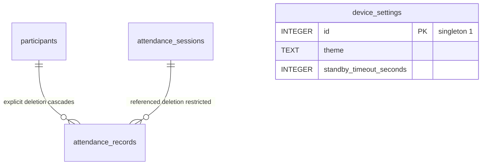

# Face Recognition

## Attendance kiosk interface and lifecycle

The optional PyQt5 Widgets interface defaults to a demonstration independent of
camera, model and dataset assets. It provides nine persistent screens: standby, attendance,
demonstration PIN access, administrator dashboard, sessions, records, export,
system status and settings. Without a database, records remain fictional. Export
controls and system-status samples remain demonstrations in every mode; live
recognition debug metrics describe the running pipeline.
The demonstration PIN is **123456**; this is navigation scaffolding, not security.

Windows development (native Qt backend, 800 × 480 window):

```powershell
python -m pip install -e ".[gui]"
$env:PYTHONPATH="src"
python -m face_recognition.presentation.gui --windowed
```

The GUI extra pins the PyQt5 binding to 5.15.11 for desktop development; it is
not a recognition-core dependency. On Raspberry Pi use the already installed
system PyQt5 / Qt 5.15.8 through a `--system-site-packages` environment. Do not
replace the working system Qt/EGLFS installation with desktop wheels.

```bash
QT_QPA_PLATFORM=eglfs PYTHONPATH=src python -m face_recognition.presentation.gui
```

EGLFS launches fullscreen; the application does not set the platform backend.
Escape closes the development application. Dark Amethyst is the default theme;
Settings → Appearance (`Ajustes → Apariencia`) switches all existing widgets to
Light Lavender immediately. Appearance and standby timeout live only in memory.
One recurring timer updates the date/time; one single-shot timer handles
Attendance inactivity. Demonstration mode starts no worker or recognition load.

The window distinguishes `LifecycleState.STANDBY`, `ATTENDANCE`, `ADMIN_LOGIN`,
`ADMIN` and terminal `SHUTDOWN` from its nine visible pages. All administrative
subviews belong to `ADMIN`. Main-content activation or sidebar Asistencia starts
a fresh Attendance countdown and clears the demo result. Deliberate clicks,
taps, keys and wheel interaction inside Attendance restart the countdown;
mouse movement does not. `Ajustes → Espera` selects 30 (default), 60 or 120 seconds.

The explicit `Simular rostro presente` checkbox is independent of the attendance
result selector: an unrecognized face is still presence. Presence stops the
timer, absence starts a new countdown, and expiry enters Standby. Leaving
Attendance clears presence/results and stops its timer. No attendance timer runs
in Standby, PIN entry or Admin. State/deadline checks reject obsolete timeouts.
Returning to Attendance or Standby clears demo authentication/PIN. Exit retains
the themed confirmation; cancellation keeps Admin active, and closing stops both
timers and announces shutdown. Standby never suspends the OS or display.

`window.lifecycle_changed` (enum) and `window.attendance_active_changed` (boolean)
announce lifecycle changes. Presence enters through `window.set_face_present(bool)`
on the GUI thread; repeated absence is idempotent and cannot postpone standby.
Without `--attendance-db`, the session page opens/closes an explicitly temporary,
in-memory session. With an explicit database it restores and manages persistent
sessions, while startup still enters Standby. Export, PIN-change, brightness,
clock and power controls remain visual placeholders. The demonstration PIN is
not production access control. GUI theme/standby preferences remain in memory.

Optional offscreen checks (skip automatically if PyQt5 is absent):

```powershell
$env:QT_QPA_PLATFORM="offscreen"
python -m unittest tests.unit.test_kiosk_gui tests.unit.test_gui_recognition
```

GUI code is contained in `presentation/gui`: `window.py` owns screens and
navigation, `themes.py` owns shared palette/style definitions, and `__main__.py`
starts the application. Only explicit live mode imports `recognition.py`, which
coordinates the existing recognition core with Qt. Demonstration mode imports no
camera, MediaPipe, NumPy or scikit-learn components.

### Live kiosk recognition

`--model-dir` opts into live recognition. The same camera/model options as the
standalone live CLI are available, including default **480 × 270** inference,
optional main-stream dimensions, landmarker asset, orientation and absence timeout.
There are no threshold, classifier or temporal overrides.

Windows PowerShell (native Qt):

```powershell
$env:PYTHONPATH="src"
python -m face_recognition.presentation.gui --windowed `
  --camera-backend opencv --camera-index 0 `
  --model-dir "..\face-recognition-data\v3\models\open_set_model_v3" --debug
```

Raspberry Pi (existing system Qt/EGLFS):

```bash
QT_QPA_PLATFORM=eglfs PYTHONPATH=src python -m face_recognition.presentation.gui \
  --camera-backend picamera2 \
  --model-dir "../face-recognition-data/v3/models/open_set_model_v3" \
  --orientation rotate180 --debug
```

Open Admin with the demonstration PIN, open a session under `Sesiones`,
then return to `Asistencia`. Capture is eligible only in Attendance with an open
session and a ready backend. Without a session the camera remains closed. The
simulation controls are hidden in live mode. Accepted temporal identities display
`Identidad reconocida` and the technical ID; rejected decisions display `Persona
no reconocida` without the SVM candidate. Recognition never means attendance has
been registered unless the explicit recording capability described below is
enabled and the database confirms success. Ordinary mode hides technical diagnostics.
The sidebar identifies whether recording is enabled. Without a database,
temporary sessions and sample records remain demonstrations. Administrative PIN
access is explicitly a demonstration in every mode.

One Qt worker loads and fully validates the trusted bundle once, retaining it
across activations. It owns camera acquisition, asynchronous MediaPipe, pose
features and the existing `LiveOpenSetRecognition` pipeline. Each activation
creates a fresh detector and temporal stream. Standby, Admin and session closure
stop processing and release the camera/detector while retaining the model.
Generation checks reject late results. Partial initialization and capture errors
release resources and show a generic Spanish error; there is no rapid retry loop.
Leaving and reentering Attendance permits a new capture attempt. Model failures
require restarting after correcting the trusted assets/runtime.

The Qt preview deliberately reuses the **low-resolution inference frame**, not a
second camera read. Picamera2 keeps its existing RGB888 main/YUV420 lores
configuration; only lores is consumed here. Existing stride-aware YUV420-to-RGB
conversion crops padding; OpenCV BGR frames resize/convert to RGB using the same
preprocessing helper. `--preview-fps` limits image generation and rendering
(default 15 FPS; actual display rate also depends on the existing coalesced GUI
refresh cadence). Each published QImage copies its pixels into Qt-owned storage;
QPixmap creation and aspect-preserving scaling occur only on the GUI thread. There is no DRM preview,
OpenCV window, zero-copy assumption or extra preview backend inside EGLFS.
`--preview-width/height` configure acquisition/main stream; the embedded preview
still uses the inference resolution. The static positioning guide remains visible.

For CPU diagnosis, compare otherwise identical live runs with `--preview-fps 0`,
`--preview-fps 5` and `--preview-fps 15`. Zero displays `Vista previa desactivada`
and skips preview RGB conversion, QImage copying, QPixmap creation, scaling and
image updates. Camera acquisition, MediaPipe, recognition, facial presence,
status/debug delivery and lifecycle handling continue unchanged. This switch
isolates preview work; it does not establish the cause of high CPU usage or
promise a performance improvement. The standalone CLI and demo mode are unchanged.

A single replaceable packet holds the latest preview/result, with coalesced Qt
notifications and a single-shot refresh timer. Slow rendering drops intermediate
packets rather than queuing frames. MediaPipe still admits one inference at a
time, skips busy submissions and consumes each completion timestamp once. No
recognition mathematics, frozen threshold or seven-observation policy changes.
Fresh detector faces, including UNKNOWN and invalid-pose faces, signal presence;
stale snapshots expire under the existing absence timeout. Repeated empty results
do not restart inactivity. All image/landmark/feature processing is in memory only.

Debug text distinguishes camera reads/s, displayed preview images/s, MediaPipe
completions/s and valid recognition observations/s. It shows MP submission-to-
callback latency separately from submission-to-V3 observation latency, plus window
occupancy, busy skips, candidate, last completed temporal score and threshold.
These are not probabilities; observation latency excludes subsequent GUI rendering.
Metrics retain the existing approximately one-second measurement interval.

Exit stops activation immediately and keeps Qt alive until the worker releases
resources and joins. Stop flags are directly thread-safe, including during a
blocking capture loop. Native camera/loader calls cannot be forcibly interrupted;
cleanup waits for them to return, so a hung driver may delay final exit. No unsafe
thread termination is used. Manual Raspberry Pi 3B+ validation passed all 17
functional acceptance checks. The operator confirmed acceptable recognition
throughput, memory consumption, temperature and effective multicore execution.
Automated tests use synthetic fixtures and do not measure hardware performance.
For future on-device comparisons, use identical camera settings and compare
callback latency with callback latency, rather than with total recognition
latency. Touchscreen deployment remains separate work.

Operational facial dataset capture, pose-feature processing, selected-model
construction and single-face open-set recognition on Windows/OpenCV and
Raspberry Pi/Picamera2. Optional attendance management is described below; this
academic prototype is not a production-ready institutional attendance system.

The completed research is preserved in Git. **`v3-open-set-model` (`755a06f`)**
preserves the frozen research/model-construction workflows; **`v2-open-set-final`**
preserves the last independently evaluated external holdout. Research commands,
CV planning, comparisons, diagnostics and discarded classifiers/scorers are no
longer executable from current HEAD.

## Installation

Python **3.11** is supported. Keep the pinned requirements; do not copy virtual
environments between Windows and Linux.

Windows PowerShell, repository root:

```powershell
python -m venv .venv
.\.venv\Scripts\Activate.ps1
python -m pip install -e .
python tools/download_face_landmarker.py
```

Alternatively activate the existing `face-recognition` Conda environment and set
`$env:PYTHONPATH="src"` when running without an editable installation.

Raspberry Pi 3B+ reference: Debian 12 Bookworm/aarch64, Camera Module 3, Python
3.11.2 and system Picamera2 0.3.31/libcamera. Install the distribution's
`python3-picamera2`/`python3-libcamera` packages, then:

```bash
python3 -m venv --system-site-packages .venv
source .venv/bin/activate
python -m pip install -r requirements-rpi.txt
python -m pip install --no-deps -e .
python tools/download_face_landmarker.py
```

Picamera2/libcamera imports are isolated and lazy; Windows does not require them.
The MediaPipe asset is `assets/face_landmarker.task`, or supply `--landmarker-model`
to live recognition. Source code, requirements and trusted model assets can be
shared; interpreters and binary packages must be installed for each architecture.

## Architecture and preview

```text
Camera (OpenCV / Picamera2)
  → asynchronous MediaPipe Face Landmarker (LIVE_STREAM)
  → pose-relative XYZ features
  → loaded ANOVA / scaler / SVM / Mahalanobis
  → seven successful observations / median / deterministic identity vote
  → KNOWN identity or UNKNOWN overlay
```

The existing `domain`, `application`, `infrastructure`, `presentation` and `config`
layers remain. Camera acquisition is platform-specific; recognition is shared.
There is one active MediaPipe request, a latest-result slot, and immediate busy
frame discard before conversion. No inference backlog, worker or frame queue is
introduced. Each completed landmark result is consumed at most once.

Preview and performance utilities:

```powershell
python -m face_recognition.presentation.cli.recognize --camera opencv --display opencv
```

```bash
PYTHONPATH=src python -m face_recognition.presentation.cli.recognize --camera picamera2 --display drm --orientation rotate180
PYTHONPATH=src python -m face_recognition.presentation.cli.recognize --camera picamera2 --display none --landmarks none
```

`--landmarks none|selected|all` controls drawing; selected mode requires
`--indices INDEX,INDEX,...`. Orientation supports `normal`, `rotate180`,
`mirror-horizontal`, `mirror-vertical`. Preview defaults are 848×480 main and
480×270 inference. Picamera2 retains the shared-crop main preview plus lores YUV
inference stream, stride-aware conversion only after reserving inference, and
native DRM preview/transparent overlay. DRM and no-display modes do not convert
camera pixels for presentation. OpenCV live capture retains device defaults
unless explicit preview dimensions are supplied.

## Guided dataset capture

Capture writes raw landmarks and session metadata, validates existing captures,
and supports explicit resume. Use pseudonymous identifiers; no participant names
or images are required. SPACE begins/advances the guided conditions; q exits.

```powershell
python -m face_recognition.presentation.cli.capture --help
python -m face_recognition.presentation.cli.capture --person-id p001 --session-id session_01 --data-root "..\face-recognition-data\data\raw"
```

Use `--camera picamera2 --display drm` on Raspberry Pi and the appropriate
`--orientation` for the physical camera. The default guided protocol covers
center, near/far, roll, yaw, pitch and four translations. Capture parameters,
complete conditions, sample order and inference dimensions remain in manifests.
Rerun the same capture command with matching session configuration to resume;
existing complete conditions are validated rather than silently overwritten. Consult `--help`
for capture timing and backend options.

## Selected pose dataset

Process raw captures into a **new external output root**:

```powershell
python -m face_recognition.presentation.cli.process_dataset `
  --raw-root "..\face-recognition-data\data\raw" `
  --output-root "..\face-recognition-data\v3\pose_processed"
```

The command emits only `all_xyz_pose_v2`: 478 landmarks × XYZ = 1434 features,
with unchanged identity/session/condition/index/timestamp provenance. Completed
outputs cannot be overwritten. Failures retain failed staging metadata and never
publish a completed dataset. Historical processed datasets remain untouched.

The exact frozen transform corrects `(x, y*height/width, z)`, averages eye groups
`[33,133]` and `[362,263]`, uses their midpoint as origin and 3D separation as
scale, and builds an orthonormal right-handed frame. Horizontal points between
the eye centers; vertical is chin `[152,148,377]` minus forehead `[10,109,338]`,
Gram–Schmidt projected off horizontal; depth is their cross product, followed by
vertical reconstruction. Coordinates are `((p-origin)/scale) @ basis`. Collapsed,
collinear or non-finite geometry fails safely. The normalization and Mahalanobis
source files are intentionally unchanged because frozen bundles fingerprint them.
MediaPipe z is relative depth, not metric 3D frontalization.

## Model construction and calibration

The frozen configuration is authoritative: `all_xyz_pose_v2`, 1434 inputs,
`SelectKBest(f_classif, k=448)`, `StandardScaler`, RBF `SVC(C=4, gamma=0.001,
probability=False)` and predicted-class regularized Mahalanobis. Covariance uses
the existing per-class Ledoit–Wolf estimate, ridge
`1e-8*max(1, trace(covariance)/dimension)` and Cholesky solve. Knownness is negative
Mahalanobis distance. There are no method/hyperparameter overrides.

Model construction uses the frozen population metadata, not new split selection:
KNOWN sessions 01–03 fit every component exactly once; KNOWN session 04 and both
sessions of all eight designated UNKNOWN identities calibrate only. Membership
is read from authenticated metadata. UNKNOWN and KNOWN calibration data never
fit preprocessing, classifier or covariance statistics. Current declared real
counts are 7800 fitting frames, 2600 KNOWN calibration frames and 4160 UNKNOWN
calibration frames; actual catalog, per-condition counts and payloads are checked.

```powershell
python -m face_recognition.presentation.cli.train_recognition_model `
  --processed-root "..\face-recognition-data\v3\pose_processed" `
  --frozen-config "..\face-recognition-data\v3\models\open_set_config_v3.json" `
  --output-dir "..\face-recognition-data\v3\models\open_set_model_v3"
```

The existing bundle is already trained; cleanup and deployment do not require
running this command. An existing output directory is refused. Training retains
read-only authentication of the frozen protocol and pose-report provenance;
`--protocol` and `--pose-report` support relocated files only when hashes match.
It does not regenerate protocols, replay experiments or select strategies.

Threshold calibration uses non-overlapping, boundary-safe windows of seven and
median scores. It maximizes binary balanced accuracy with exact integer
comparisons, then lower FAR, lower FRR and higher numeric threshold. Enumeration
retains observed scores, finite interior midpoints and accept/reject boundaries.
AUC/EER are diagnostics. **No refit follows calibration**:
`threshold_transport="none_same_model_calibration"`. Component and full-state
fingerprints before and after calibration must match.

Calibration metrics are not independent test/generalization performance. No new
untouched V3 holdout exists; V2 remains the last independent external holdout.

## Model bundle and loading

```text
open_set_model_v3/
  model.joblib
  frozen_config.json
  manifest.json
```

Publication stages and round-trips artifacts, writes the completion manifest
last, verifies hashes/state and publishes the directory without overwrite.
The manifest contains aggregate calibration counts/metrics, provenance and
fingerprints. It does not contain raw features, individual scores or predictions.
The fitted selector/scaler/SVM/Mahalanobis state is biometric-derived and local.

```python
from face_recognition.infrastructure.persistence.recognition_model import load_recognition_bundle
recognizer = load_recognition_bundle(model_directory)
# features: seven finite all_xyz_pose_v2 rows, shape (7, 1434)
decision = recognizer.predict_window(features)
# decision.identity is None for UNKNOWN; score is a distance-derived value.
```

Only load trusted local joblib bundles: integrity hashes are not authenticity
signatures. Startup verifies manifest/artifact SHA-256, configuration,
implementation fingerprints, fitted structure, learned-state fingerprints and
calibration consistency before camera access. Python **major.minor** must match;
patch releases may differ. Recorded NumPy, SciPy and scikit-learn versions must
match exactly. No dependency upgrade or validation bypass is provided.

Historical internal class/module paths (`v3_open_set_config`,
`v3_deployable_model`, `sklearn_v3_novelty.FittedV3Identity`, `EvaluationVersions`)
remain where serialized objects and canonical fingerprints require them. They
contain compatibility schemas, not executable experiment workflows. Bundle/schema
identifiers, representation IDs, manifest builder IDs and frozen source hashes
are preserved; existing bundles need no migration.

Live inference uses lightweight fit-generation, component-identity and frozen
contract guards. It never rehashes/serializes large learned arrays per frame.
`recognizer.verify_integrity()` remains an explicit expensive diagnostic outside
the hot loop; lightweight guards do not detect arbitrary in-place array edits.

## Live recognition

Windows PowerShell:

```powershell
python -m face_recognition.presentation.cli.live_recognition `
  --camera-backend opencv --camera-index 0 `
  --model-dir "..\face-recognition-data\v3\models\open_set_model_v3"
```

Raspberry Pi:

```bash
PYTHONPATH=src python -m face_recognition.presentation.cli.live_recognition \
  --camera-backend picamera2 \
  --model-dir "../face-recognition-data/v3/models/open_set_model_v3"
```

Copy the entire unchanged three-file bundle, source package and MediaPipe task
asset to the Pi. No raw/processed dataset or experimental report is required for
live inference. OpenCV exits with q, ESC or Ctrl+C; native DRM exits with Ctrl+C.
Camera, detector, display and native preview resources close on errors and exit.

Seven **successful face inferences** form a non-overlapping window. Identity uses
plurality, ties by summed corresponding SVM decision scores across all seven
observations, then class order. Score uses median, without a consistency gate.
Accept `score >= persisted threshold` (current bundle: approximately
**-18.1917360542**). UNKNOWN suppresses the arbitrary SVM candidate identity.
The completed decision/score remains visible while the next window fills.

An observed no-face result or invalid pose immediately clears the partial
window. After `--absence-timeout` seconds (default 2), the last decision, score,
candidate and box clear to NO FACE. Old callbacks are rejected; a long gap before
reappearance resets partial observations. Single-face mode uses the first
returned face deterministically, without multi-face tracking or identity gates.

Normal overlay: face box, stable identity/UNKNOWN, last completed temporal score,
threshold, inference FPS, submission-to-V3 latency, window occupancy and camera
read FPS. `--debug` adds frame/temporal candidates, frame score, completions,
callback/busy counts and coarse **Pose+features / V3 observation** milliseconds.
Scores are not probabilities; there is no confidence percentage.

## Performance and tests

Camera FPS counts reads, not native DRM refresh. Live inference FPS counts
successfully consumed pose+recognition completions, excluding dropped/busy,
no-face and reused results. Live latency runs from MediaPipe submission through
callback/main-loop/pose/recognition/temporal completion. Preview inference FPS
counts callbacks, including no face. Preview timing breaks down preprocessing,
dispatch, async result and total callback time; reused results retain their timing.
Debug coarse timings do not change those callback semantics or add per-frame logs.

The retained LIVE_STREAM design previously measured about 7–8 active-face
MediaPipe completions/s and 114–120 ms callback latency on Raspberry Pi 3B+.
These are hardware observations, not an end-to-end recognition guarantee.

Hardware-free tests use synthetic fixtures and temporary directories only:

```powershell
$env:PYTHONPATH="src"
python -m unittest discover -s tests
git diff --check
```

On machines with heavily oversubscribed native numerical libraries, optionally
set `OPENBLAS_NUM_THREADS=1`, `OMP_NUM_THREADS=1`, `MKL_NUM_THREADS=1` for testing.
No test accesses the external biometric data tree or requires camera hardware.

## Research evidence and limitations

The following independent final holdout results are historical records only:

| Final metric | V1 | V2 |
| --- | ---: | ---: |
| Closed-set frame accuracy | 0.927692 | 0.878462 |
| Temporal ROC AUC | 0.736982 | 0.727761 |
| UNKNOWN false-acceptance rate (FAR) | 0.198718 | 0.416667 |
| KNOWN false-rejection rate (FRR) | 0.450000 | 0.280769 |
| Open-set exact accuracy | 0.644231 | 0.649038 |

V2 evaluated 10 known identities / 10 sessions / 2600 frames and 3 new unknown
identities / 6 sessions / 1560 frames. Its final closed-set macro F1 was 0.876944.
Its selected development temporal AUC/open-set accuracy were 0.846953/0.774231,
which did not transfer to the independent final population. Lower known false
rejection came with unacceptably high false acceptance on new unknown identities.
Calibration and development results are not final generalization measurements.

Neither archived model may be retuned from these final results. Changes to
normalization, features, rejection/threshold policy, classifier or temporal
policy belong to a new model version and experimental protocol.

The completed iterative comparison selected **all_xyz_pose_v2** under the
predeclared highest-mean-outer-balanced-accuracy rule. These are development
cross-validation results, **not independent final generalization**:

| Metric | all_xyz_v1 | all_xyz_pose_v2 |
| --- | ---: | ---: |
| Closed-set accuracy | 0.897500 | 0.948173 |
| Closed-set macro F1 | 0.897409 | 0.948020 |
| ROC AUC | 0.835956 | 0.890893 |
| EER | 0.229808 | 0.179567 |
| FAR | 0.120192 | 0.098558 |
| FRR | 0.302885 | 0.261538 |
| Open-set exact accuracy | 0.745879 | 0.782280 |
| Binary balanced accuracy | 0.788462 | 0.819952 |

Global improvement does not resolve pose sensitivity. KNOWN yaw-left FRR fell
from 0.725000 to 0.662500, and yaw-right from 0.862500 to 0.762500; both remain
difficult. Pitch-up did not improve (0.500000 to 0.512500); pitch-down remained
0.412500. Session/context variation and harder-to-reject UNKNOWN identities
(including p009 in prior diagnostics) remain limitations. MediaPipe relative
depth is not metric 3D geometry. These limitations motivate no tuning in the
freeze workflow.


The cross-validated representation comparison is iterative development evidence;
it is not an independent final holdout. V3 research/model-selection commands are
available only from the frozen historical tag. Residual yaw/pitch sensitivity,
session/context variation and harder-to-reject UNKNOWN identities remain known
limitations. No explicit lighting labels exist. Do not retune frozen model
versions from archived final results.

## Attendance management

Four modes are deliberately separate:

| Launch options | Behavior |
| --- | --- |
| Neither database nor model | Existing nonpersistent, hardware-independent demonstration |
| `--attendance-db` only | Persistent **synthetic demonstration**, no camera or biometric assets |
| `--model-dir`, without recording opt-in | Live recognition; accepted decisions say `Identidad reconocida`. An optional database provides sessions/records, but recognition does not write attendance |
| Model + database + `--enable-attendance-recording` | Explicit live persistent attendance capability for pre-registered identifiers |

The recording flag requires both paths. It enables software behavior only; it
does not establish authorization or valid consent. Never repurpose a synthetic
testing database for operational collection. The default startup creates no
database, enrolls no participants and generates no attendance.

Register fictional participants explicitly before synthetic acceptance testing:

```bash
PYTHONPATH=src python -m face_recognition.presentation.cli.attendance_participants \
  --attendance-db "$HOME/.local/share/face-recognition/synthetic-attendance.sqlite3" add p001
PYTHONPATH=src python -m face_recognition.presentation.cli.attendance_participants \
  --attendance-db "$HOME/.local/share/face-recognition/synthetic-attendance.sqlite3" list
QT_QPA_PLATFORM=eglfs PYTHONPATH=src python -m face_recognition.presentation.gui \
  --attendance-db "$HOME/.local/share/face-recognition/synthetic-attendance.sqlite3"
```

Windows PowerShell equivalent (native Qt, repository root):

```powershell
$env:PYTHONPATH="src"
$syntheticDb=Join-Path $env:LOCALAPPDATA "face-recognition\synthetic-attendance.sqlite3"
python -m face_recognition.presentation.cli.attendance_participants --attendance-db "$syntheticDb" add p001
python -m face_recognition.presentation.cli.attendance_participants --attendance-db "$syntheticDb" list
python -m face_recognition.presentation.gui --windowed --attendance-db "$syntheticDb"
```

Participant commands initialize only the explicitly selected database, reject
duplicate/invalid identifiers and never inspect models to discover participants.
There are no names, identity mappings or enrollment operations. Registration of
an identifier does not establish consent.

Use PIN `123456`, enter `Sesiones → Crear sesión`, supply a name and an explicit
calendar date, then select `Crear e iniciar sesión`.
Return to `Asistencia`: select `p001 · Aceptar` and click `Simular decisión`.
Repeat for duplicate attendance; select `UNKNOWN · Rechazar` for no write, or
`p003 · Aceptar` to test an unregistered identifier (leave p003 unregistered).
Simulated decisions use the same service and real SQLite constraints as live
decisions, but no facial data. The controls stay hidden in live mode.

Persistent sessions have authoritative database-generated IDs, names, opening
times, open/closed state, activation revisions and counts. Camera activation still requires Attendance
and an open session; opening in Admin does not start capture. Closing preserves
history, stops eligibility and clears transient results. Exiting the application
does **not** close a session. Restart restores any open session, initially in
Standby. Temporary sessions remain available when no database is supplied.

An attendance session is **one event identified by normalized name and explicit
calendar date**. `Optimización` on 2026-11-16 and on 2026-11-23 are different
sessions; a participant can attend each once. Different names can share a date.
Name normalization remains Unicode NFC, whitespace trim/collapse, case folding
and NFC again; display case and accents are preserved (`Inglés` differs from
`Ingles`). Whitespace controls collapse; other controls/format characters are
rejected. SQLite `NOCASE` is not used.

The existing Sesiones screen has three tabs, with active-session information and
`Cerrar sesión activa` accessible above them:

- **Crear sesión:** name and `QDateEdit` (today by default), then `Crear e iniciar
  sesión`. Creation always inserts a new event. An existing name/date reports
  `Ya existe una sesión con ese nombre y fecha. Selecciónala en Gestionar sesiones.`
  It never resumes implicitly. Another active event blocks creation.
- **Gestionar sesiones:** linked name/date selectors. Dates list only events for
  the selected normalized name; the selected event ID is authoritative. The
  summary shows name, event date, state and count. `Reanudar sesión` preserves ID,
  event date, original opening time and all attendance/timestamps, clears
  `closed_at` and advances the activation revision only on a closed-to-open
  transition. Existing attendance remains a duplicate for that event. `Editar
  sesión` provides name/date inputs and explicit `Guardar cambios`/`Cancelar`;
  editing is restricted to closed sessions and rejects name/date collisions.
- **Eliminar sesiones:** three targeted operations described below, disabled by
  default. The scope mirrors the management selection with name, date and count.

Session dates are Python `datetime.date` values stored as `YYYY-MM-DD`; they are
not opening timestamps or registration timestamps. Editing the event date never
rewrites `registered_at`. Renaming/editing changes only the selected event, not
other dates with the same normalized name. Selectors preserve event IDs on refresh;
counts use one grouped query. `closed_at` is current closure state, not a full
activation audit log. All four launch modes, Standby, theme handling, preview FPS
and camera lifecycle remain unchanged. No global reset, session activation-history
table or production authentication is added.

### Targeted synthetic deletion only

Deletion is available only when explicitly launched with an isolated, disposable
synthetic database and **no model/live recording**:

```bash
QT_QPA_PLATFORM=eglfs PYTHONPATH=src python -m face_recognition.presentation.gui \
  --attendance-db "$HOME/.local/share/face-recognition/disposable-synthetic.sqlite3" \
  --enable-synthetic-session-deletion
```

On Windows use `--windowed` and the same database/deletion flags with native Qt.
`--enable-synthetic-session-deletion` requires `--attendance-db` and rejects
`--model-dir` or `--enable-attendance-recording`. Service and repository checks
also enforce the synthetic authorization context; hiding buttons is not the only
boundary. The flag does not establish database provenance, consent or production
access control. Never select an operational database. There is no unrestricted
deletion CLI.

| Action | Deleted | Preserved |
| --- | --- | --- |
| `Vaciar asistencias de esta sesión` | Records for the selected name/date event | That event's ID/name/date/opening time; other events; participants/settings |
| `Eliminar sesión de esta fecha` | Selected event and its records | Other dates and names; participants/settings |
| `Eliminar sesiones de todas las fechas` | All events and records for the selected normalized name | Other names and their records; participants/settings |

All three operations reject while **any** session is active, in both service and
transaction checks. Empty target scopes are disabled. Every action prepares a
read-only preview and opens its own themed confirmation with actual names, dates,
affected/deleted session counts, record counts, preservation explanation and an
application-irreversibility warning. All-dates summaries list every date/count
inside a scroll area. `Cancelar` is the default; Escape or closing the dialog
writes nothing. A specific destructive button is required to execute.

Confirmed execution takes `BEGIN IMMEDIATE`, rechecks active sessions and compares
the exact selected scope and full session/record snapshot against the preview,
including row identities and values, not just totals. Changed records, equal-count
replacements, edited targets or added dates abort and require a new confirmation.
Records are deleted first, then sessions where applicable, respecting the existing
`ON DELETE RESTRICT`. Both changes commit together or roll back. Actual deleted
counts are reported and selectors/Records filters refresh. No database file is
replaced or removed, and no participant, setting, credential, model or biometric
file is deleted. Clearing records preserves the event for later resumption and
fresh attendance.

The two integer identity tables use SQLite **AUTOINCREMENT** and guards against
explicit reuse/mutation of IDs. SQLite's internal `sqlite_sequence` high-water
marks survive targeted deletion, including deletion of the last event/record.
Never reset them manually. A deleted event recreated with the same name/date has
a new ID; stale recognition cannot target it. The same rule prevents a newly
inserted record with identical values from masquerading as a confirmed old record.
Activation revisions, worker generations, temporal decision sequences, freshness
and face-segment checks remain required. Clearing then resuming still advances
activation revision, rejecting old decisions. No recognition math changes.

Global reset, production administrator authentication/reauthentication and safe
system power controls remain Phase 6 work. This prototype's demonstration PIN is
not production authorization. Administrative attendance deletion is distinct from
biometric-data suppression and does not securely erase storage pages, journals,
backups or flash.

`AttendanceService` coordinates session operations, participant eligibility,
duplicate results, grouped counts and record filters over the existing repositories.
SQLite schema version **3** preserves all four business tables. New registrations show `Asistencia
registrada`; duplicates show `Asistencia ya registrada` with the **original**
registration time. Missing participants, closed sessions and storage failures
produce distinct Spanish outcomes, never false success or temporary fallback.
Confirmation remains visible while the same face segment continues; leaving
Attendance, losing presence or changing session clears it.

Only completed temporal windows carry a decision sequence and completion time.
The sequence changes once per window, independently of general view revisions.
The GUI consumes it at most once per activation, requires a current valid face
segment, rejects expired evidence and binds it to the active session ID **and
activation revision**, as well as the recognition worker generation. No-face
or invalid-pose interruptions invalidate cached attendance evidence while leaving
the existing recognition grace-period display unchanged. Rejected decisions and
individual frame candidates never write. Coalesced packets may skip intermediate
decisions; no unbounded decision/frame queue or per-frame database query is added.
The existing atomic repository insertion remains the final authority on session
validity, expected revision and uniqueness in the same `BEGIN IMMEDIATE`
transaction. A close/resume of the same ID cannot admit a pending request from its
old activation. Revision changes reset the worker generation, temporal stream and
transient confirmation state. No recognition mathematics or fitted artifacts change.

`Registros` reads SQLite on entry or filter changes, including closed-session
history. Its session selector defaults to `Todas las sesiones`; its date filter
defaults to checked with today's local date. Combine session and date, or disable
the date filter for a selected session's full history. Without both a session and
a date restriction, the UI requests a selection and the repository refuses an
unrestricted query. Results show participant, current session name, local date
and time, and total/empty state, in chronological order. Filtering uses IDs,
never mutable display names. Records and session names are queried in batches,
not per table cell.
The selected local day's start and the **next local day's start** are resolved
independently by Qt's system timezone and converted to UTC for `[start,end)`;
days spanning offset changes need not be 24 hours. Stored datetimes remain aware UTC.

Persistence runs synchronously on explicit GUI actions/eligible decision events,
using separate short-lived connections and a **150 ms busy timeout** in the GUI
and participant CLI. It does not run inside camera capture, MediaPipe callbacks
or the recognition worker. Recoverable failures leave navigation/exit available;
failed initialization disables persistent session controls instead of falling
back. No additional worker, timer-based database polling or persistent settings
integration is introduced. A busy database can briefly delay GUI delivery; camera
processing continues and old packets are still rejected.

Live recording capability example only, after privacy/access-control review and
with a separate reviewed database (do not execute against real data for testing):

```bash
QT_QPA_PLATFORM=eglfs PYTHONPATH=src python -m face_recognition.presentation.gui \
  --camera-backend picamera2 --orientation rotate180 \
  --model-dir "../face-recognition-data/v3/models/open_set_model_v3" \
  --attendance-db "/path/to/reviewed-attendance.sqlite3" \
  --enable-attendance-recording --preview-fps 15 --debug
```

On Windows, use the same flags with `--windowed --camera-backend opencv
--camera-index 0` and native Qt. Omitting the recording flag preserves identity-only
live behavior. `--preview-fps 0` still disables image work without stopping recognition.

Focused Raspberry Pi validation, synthetic fixtures only (no training tests):

```bash
QT_QPA_PLATFORM=offscreen PYTHONPATH=src python -m unittest \
  tests.unit.test_attendance_persistence tests.unit.test_attendance_service \
  tests.unit.test_attendance_sessions tests.unit.test_session_dates_deletion \
  tests.unit.test_gui_attendance tests.unit.test_kiosk_gui \
  tests.unit.test_gui_recognition tests.unit.test_live_open_set_recognition \
  tests.integration.test_live_open_set_cli
```

Phase 4's 27 persistence checks passed on Raspberry Pi, including POSIX
permissions. Its complete Pi suite was manually interrupted after about 20
minutes; it is **not** recorded as a full-suite pass. The initial Phase 5 focused
suite (114 checks) and 18 functional acceptance checks subsequently passed on Pi.
The dated-session/deletion revision also passed targeted and manual Pi acceptance
checks, as reported by the operator. The pre-merge cleanup must still be checked
on Pi using the focused command above; no new hardware measurements are claimed.
Windows development should also run `python -m unittest discover
-s tests` with `PYTHONPATH=src` and the Qt offscreen backend.

## SQLite schema and privacy

Standard-library `sqlite3` provides local storage without an ORM, server or new
dependency. Repositories are used through the attendance service above. GUI
settings and administrator PIN remain demonstrations. Only an explicit
`--attendance-db` initializes storage; module imports and ordinary demonstration
startup never create or open a database.

Supply an explicit database path outside the source repository, biometric dataset
and model bundle. A possible future Linux location is
`~/.local/share/face-recognition/attendance.sqlite3`; no production location is
created automatically. With `db_path` supplied by the caller:

```python
from face_recognition.infrastructure.persistence.attendance_database import AttendanceDatabase
from face_recognition.infrastructure.persistence.attendance_repositories import SQLiteDeviceSettingsRepository

database = AttendanceDatabase(db_path)
database.initialize()
settings = SQLiteDeviceSettingsRepository(database).get()
```

Initialization uses `PRAGMA user_version`: version 0 creates schema **3** directly;
version 1 follows its supported normalization/collision migration to v2 and then
v3; version 2 migrates to v3; version 3 validates and reopens. Unsupported versions,
nonempty unversioned databases and incomplete/weakened schemas fail explicitly.
Defaults are inserted only for a new database. No automatic recovery/reset occurs.

Migration to v3 infers each event date from its original aware UTC `opened_at`
converted using the device's local timezone rules for that instant. The
`AttendanceDatabase(..., migration_timezone=tzinfo)` boundary allows deterministic
synthetic timezone tests; normal GUI initialization uses the OS local timezone.
These dates are **inferred** and can be corrected by editing closed sessions.
Stored names, including date-looking text, are not parsed or rewritten.

SQLite cannot ALTER an integer primary key into AUTOINCREMENT. The v2→v3 migration
therefore rebuilds only sessions and their dependent records inside one transaction,
with foreign keys **ON** throughout: copy parent/child rows preserving IDs, drop
old child before old parent, rename the copied tables and recreate constraints.
This migration-only rebuild is necessary for non-reusing identities; destructive
session actions themselves use only targeted DELETE statements, never DROP/reset.
There remain four business tables; `sqlite_sequence` is SQLite's internal allocator.
New and migrated databases enforce the same date/composite-uniqueness/identity
constraints. Original timestamps, revisions, participants, records, settings and
file protection are preserved. Integrity/FK checks precede the version update and
commit; any failure rolls back the entire migration. Genuine v1 and v2 schema
fixtures test this path. Existing v1 normalized-name collisions still require
deliberate offline maintenance; they are never automatically merged or discarded.

| Table | Columns and principal constraints |
| --- | --- |
| `participants` | `person_id TEXT PRIMARY KEY NOT NULL`, `created_at TEXT NOT NULL` |
| `attendance_sessions` | `id INTEGER PRIMARY KEY AUTOINCREMENT`, nonempty `name`/`name_key`, valid NOT NULL `session_date`, unique `(name_key, session_date)`, UTC opening/closure times, positive `activation_revision` |
| `attendance_records` | `id INTEGER PRIMARY KEY AUTOINCREMENT`, `person_id NOT NULL` FK, `attendance_session_id NOT NULL` FK, `registered_at NOT NULL`; unique `(attendance_session_id, person_id)` |
| `device_settings` | `id INTEGER PRIMARY KEY CHECK(id=1)`, `theme` limited to `dark/light`, integer timeout limited to `30/60/120`; both preferences NOT NULL |



An attendance session is open exactly when `closed_at IS NULL`. A partial unique
index on the constant `1` for open rows enforces at most one open session, even
for competing writers. Attendance IDs are independent integer IDs, unrelated to
biometric capture names such as `session_01`. Technical participant IDs use `p`
followed by at least three ASCII digits (for example fictional `p001`). They must
be registered explicitly; no identity or enrollment is inferred from model output.

All four domain dataclasses live in `domain.models.attendance`; they have no SQLite,
Qt or ML dependency. The focused infrastructure repositories expose:

| Repository | Operations |
| --- | --- |
| `SQLiteParticipantRepository` | `add`, `get`, `list`, `exists`, explicit `delete` |
| `SQLiteAttendanceSessionRepository` | `open`, `get`, `current`, `close`, chronological `list` |
| `SQLiteAttendanceRecordRepository` | `add`, `get`, `list_for_session`, `list_for_participant`, `list_between`, `count_for_session` |
| `SQLiteDeviceSettingsRepository` | `get`, `update_theme`, `update_standby_timeout` |

Construct repositories with the initialized `AttendanceDatabase`. Writes require
explicit timezone-aware `datetime` arguments. Dataclasses normalize these to UTC;
storage uses fixed microsecond ISO 8601 `YYYY-MM-DDTHH:MM:SS.ffffffZ`. Database CHECKs
reject malformed timestamps; canonical UTC text supports chronological ordering.
`list_between(start, end)` requires `start < end` and uses **[start, end)**. Lists
use deterministic ID tie-breaks for equal timestamps. The GUI performs local
timezone conversion for display.

Each operation owns a short-lived connection with foreign keys enabled, the
default 5-second busy timeout and unchanged `check_same_thread` enforcement. No
connections are shared between threads. Writes use `BEGIN IMMEDIATE`: session
validation and attendance insertion hold one write reservation, so concurrent
closure/deletion cannot slip between them. Reads use short consistent transactions.
Successful operations commit; failures roll back; connections always close.

Session repositories also provide name/date lookup, distinct names and available
dates, explicit `resume`, closed-event `edit`, and grouped `list_with_counts`.
Creation rejects existing name/date pairs; resumption is explicit by session ID.
The service exposes these operations as focused outcomes (created, resumed,
already active, conflicting active session, duplicate name, missing session, failure).
The repository generates the canonical Unicode key; database uniqueness and
INSERT/UPDATE triggers reject missing/empty/NUL-containing keys. An empty column
default permits safe ALTER backfill but is rejected on every subsequent write.
Reopening also validates that stored keys match the domain normalization policy.

`records.add(..., expected_activation_revision=revision)` returns `(record, created)`.
The revision must come from the activation that produced the decision; it must not
be refreshed to the latest revision to retry a stale request. For existing initial-
activation callers, omission means **1**, not "whichever activation is current".
A duplicate in an open session with the correct revision
returns the original record and `False`, preserving its timestamp. Closed sessions
and mismatched revisions reject registration, including repeated requests. The
filtered `query` accepts a session, a half-open UTC range, or both; it refuses
unrestricted all-session history. No `INSERT OR REPLACE` is used.
The existing unique index serves session lookups/counts; additional indexes serve
participant/time and timestamp-range queries. There is no duplicate session index.

Deleting a participant explicitly cascades their attendance records in the same
transaction. Session deletion is restricted while records reference it; closing
never deletes history. Missing mutation targets raise `LookupError`; invalid input,
duplicates, closed-session writes and incompatible versions raise `ValueError`.
`get` methods return `None` when absent. Storage, corruption and locking errors
raise `AttendancePersistenceError` with the original SQLite exception chained.

The default **DELETE rollback journal** is retained; short, low-frequency writes
can wait for readers, and competing writers serialize. No WAL, connection pool,
database thread or automatic backup is added. New files use POSIX mode `0600` and
new directories `0700`, subject to the caller's umask; existing parent permissions
are not changed. On Windows, access protection depends on filesystem ACLs. SQLite
is **not encrypted at rest**. Git ignores database files and their sidecars/backups;
keep any differently named copies outside Git as well.

Synthetic persistence checks create temporary databases only:

```bash
PYTHONPATH=src python -m unittest tests.unit.test_attendance_persistence
```

Pseudonymous attendance data is not anonymous and a participant row does not prove
consent. The schema stores no names, identity mappings, biometric payloads, scores,
unknown-face events or credentials. Before real collection, review authorization,
retention, withdrawal and deletion obligations, including the project's
**December 31, 2026 biometric-processing deadline**. This foundation does not
authorize indefinite retention of participant-related records or trained artifacts.
SQL deletion is not secure erasure of storage pages, journals, backups or flash.
Real participant collection is not authorized by this implementation. Withdrawal
workflows, production access control, retention jobs and export remain unimplemented.

## Privacy

Raw landmarks, processed features, trained selectors/scalers/SVMs, covariance
references and model bundles are sensitive biometric-derived artifacts. Keep
all generated data and bundles local and outside Git. Existing `.gitignore`
protections for datasets, `models/`, `*.joblib`, `*.npz`, MediaPipe assets and
secrets remain. Do not put participant names, raw payloads, individual predictions
or scores in documentation. Attendance integration is an explicitly enabled
academic capability; no camera payload, rejected identity, score or recognition
history is persisted. Purpose, authorization, retention, withdrawal, deletion and
access-control requirements must be verified before real participant collection.
